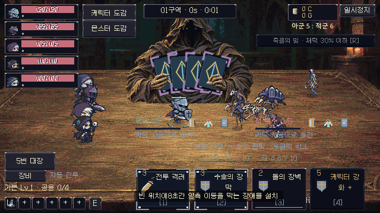

## 작업 결과

구현·GPU 실행 캡처·문서 갱신 완료. 전체 전투 플레이와 미감 승인은 미확인입니다.

## 변경 내용

### 적용 내용

ImageGen 테이블/실내 배경을 제작하고 원본·해시를 보존했습니다. 기존 땅 타일/무작위 지형 대신 테이블 배경을 직접 렌더하고 상대 몸통·양팔을1.75배 확대해 전투 배우 뒤 건너편에 배치했습니다. 테이블 고정 시점·세로0.5 원근과 이동/카드 클릭 역변환, 상판 내부 이동 제한을 연결했습니다. 설치 카드 장애물은 유지했습니다. 얼굴을 가리던 계약 버튼을 옮겼습니다. 완료 시 실제 화면과 보고를 남기는 사용자 상시 요청을 프로젝트 지침에 반영했습니다.

## 검증

Godot4.7.2 OpenGL3.3/NVIDIA GTX970 실제 실행에서640×360 캡처 저장 성공. 로그 ACTUAL_GAME_CAPTURE result=0 mode=battle own_hand=4 opposing_backs=4. 배경 잘림·배우가 테이블 위에 놓이는지·상대 확대를 캡처로 확인하고 해당 결함 수정 후 최종 촬영했습니다. 환경 에디터 설정/셰이더 캐시 쓰기 경고가 있으나 자산 임포트와 GPU 렌더는 성공했습니다. 원본 사용자 저장 대신.tools 전용 캡처 저장 사용. 테스트 작성·실행 없음.

## 남은 사항

장시간 전투·사용자 실제 클릭 조작·최종 미감 승인 미확인. 게임 패키지 빌드·게임 배포·프로젝트 푸시 미실행. 중앙 게시·HTTPS는publication 별도 기록. 일반 교훈 추가 없음; 사용자 전장/캡처 방향만 지침에 통합.

## 작업 시간

- 제안 시간: 약10분
- 실제로 완료된 시간: 2026-11-20 05:37:45 KST 시작, 2026-11-20 05:41:53 KST 구현·캡처 완료. 실측249초. 게시 완료는publication 별도 기록.
- XERJ: 미사용 — 사용자 지침에 따라 사용하지 않았습니다.
