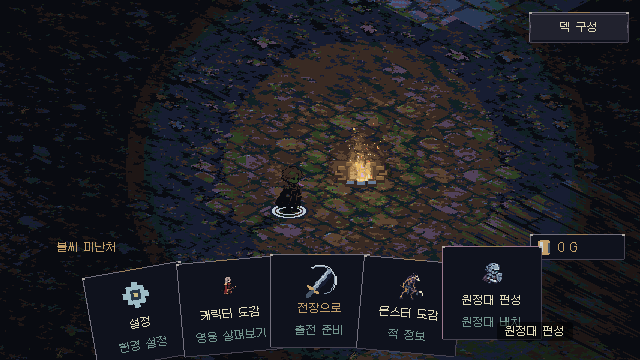
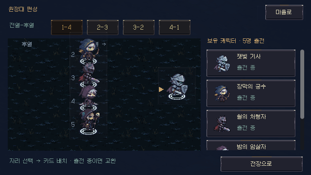

## 작업 결과

Godot 실제 캡처2장 저장·육안 확인, 프로젝트 웹 이미지 갱신, 전역 지침 설치본·저장소 원문 동기화 완료.

## 변경 내용

### 적용 내용

기존 일반 작업 자동 캡처 생략 문구를 정리하고 모든 결과 보고의 시각자료 기본 포함 규칙으로 통합했습니다. 정적 UI·명칭은 이미지, 짧은 동작은 GIF, 긴 진행·음향은 영상으로 선택하며 채팅과 중앙 보고 양쪽에 첨부합니다. 사용자 작업·포커스 보호, 실제 대상과 시안 구분, 과거 증거 창작 금지는 유지합니다. 이미 실행 중인 다른 세션 자동 전파는 단정하지 않습니다.

### 실제 마을 화면

### 실제 원정대 편성 화면

## 검증

Godot4.7.2 엔진 root.get_texture().get_image().save_png 직접 캡처. 두 PNG 육안 확인 및 원정대 표기 확인. NAMING_CAPTURE town+formation data_errors=[]. 컴퓨터 유즈·운영체제 화면 캡처는 사용하지 않았습니다. node docs/build.mjs 성공. 전역 설치본과 저장소 원문의 SHA256 일치: F8073B9457CCC95755920EAE0C63F7D979A05ED1B4A241756ED88075B3222299. 별도 테스트·회귀 테스트 미실행.

## 남은 사항

이번 변경은 정적 명칭·화면 확인이라 PNG2장을 사용했습니다. GIF·영상으로 동작을 검증한 작업은 아닙니다. 기존 user 로그·셰이더 캐시 저장 권한 오류와 종료 자원 경고는 있으나 캡처 저장과 화면 확인은 완료했습니다. 게임 배포 미실행. 중앙 게시·미디어 HTTPS는 별도 확인합니다.

## 작업 시간

- 제안 시간: 2026-11-20 05:51:31 KST 시작, 약5~8분 예상.
- 실제로 완료된 시간: 캡처·지침 동기화·문서 반영 완료 2026-11-19T20:54:10.054Z (UTC, KST는+9시간). 실측 159초. 등록·게시 확인 시간은 별도 기록.
- XERJ: 미사용 — 사용자 지침에 따라 미사용. 기존 지침 원문·엔진 실행·이미지 파일·해시로 확인했습니다.
