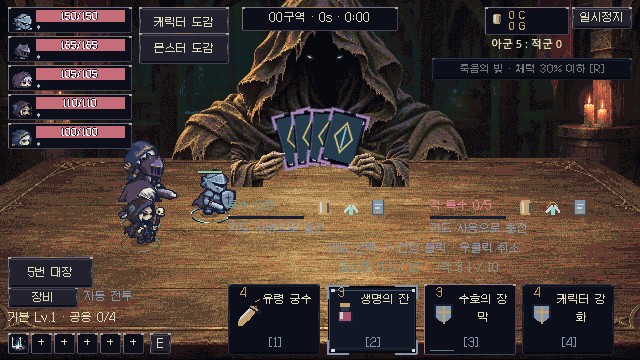

## 작업 결과

구현·실제 GPU 캡처/6초 GIF·데이터 시트·웹 문서 빌드 완료. 최종 대사/미감 승인은 대기입니다.

## 변경 내용

### 적용 내용

테이블 바깥에서 카드를 쥔 양측은 지휘관이고 상판 배우는 운용 부대로 설정을 정리했습니다. commander_speech.gd가 상대 머리 옆의 꼬리 달린 말풍선에 이름/대사를 표시합니다. commander_dialogue.json에 전투 시작·적 카드·내 카드 반응·다음 부대·궁지·적 잭팟·내 잭팟7상황을 정의하고 실행 이벤트에 연결했습니다. 전투 시계 기준 초당24자 순차 표시·5.5초 유지/표시 간격·높은 우선순위만 끼어들기·모달 숨김으로 전투를 멈추거나 말풍선이 잦게 겹치지 않게 했습니다. 새 데이터의 시트 스키마/생성기 매핑·기획·프로젝트 지침·실제 게임 GIF를 웹 문서에 반영했습니다.

## 검증

Godot4.7.2 OpenGL3.3/NVIDIA GTX970 실제 루트 실행에서640×360 이미지 저장 성공 및 말풍선/첫 대사를 시각 확인했습니다. 동일 게임에서90프레임을 엔진 API로 직접 저장해 약15fps·6초 GIF로 인코딩했습니다. COMMANDER_DIALOGUE_RECORD frames=90 fps=15 current_text=지휘관 대 지휘관… 네 패를 보여라. battle_clock=6.01666666666665 paused=false 로그 확인. 파싱/런타임 오류 없이 완료했으며 환경의 user:// 셰이더 캐시 쓰기 경고만 발생했습니다. 기존 사용자 저장에 간섭하지 않는.tools 캡처 저장 사용. node tools/build-design-catalog.mjs 및 node docs/build.mjs 성공. 테스트 작성·실행 없음.

## 남은 사항

첫 대사와 전투 지속을 실제 시각 확인했으며 모든 상황별 대사 분기·우선순위 전환의 별도 조작 확인은 미실행입니다. 대사 문구·캐릭터 성격·말풍선 위치 최종 승인은 대기입니다. 음성은 제작하지 않았습니다. 게임 패키지 빌드·게임 배포·프로젝트 푸시 미실행. 중앙 보고/미디어 공개 확인은publication에 기록합니다. 일반 교훈 추가 없음; 사용자 설정을 프로젝트 지침에 통합했습니다.

## 작업 시간

- 제안 시간: 약10분
- 실제로 완료된 시간: 2026-11-20 05:59:57 KST 시작, 2026-11-20 06:02:58 KST 구현·실제 렌더·문서 완료, 실측181초. 게시 완료는publication에 기록합니다.
- XERJ: 미사용 — 사용자 지침에 따라 사용하지 않았습니다.
