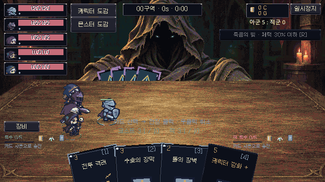

## 작업 결과

구현·실제 Godot GPU 실행·7초 GIF·웹 문서 갱신 완료. 중앙 푸시/배포/공개 확인은publication에 별도 기록합니다.

## 변경 내용

### 적용 내용

상대 몸통·팔·카드 레이어를 테이블 뒤로 통일했습니다. 시작0.6초 얼굴 노출 후2.6초까지 몸을135px 올리고 테이블·부대 시점을25px 이동합니다. 전장 클릭 역변환을 함께 맞췄습니다. reduced_motion은 즉시 최종 구도입니다. 좌하단 스킬 UI/숨은 슬롯 툴팁/5번 대장 보조 버튼을 숨겼습니다. 전투 손패를 하단 중앙4장 부채꼴로 배치하고 호버·선택 상승/회전 완화·강화/비용/이름 표시를 유지합니다. 기존 카드 동작과 실제 AI 전투는 계속됩니다.

## 검증

Godot4.7.2 OpenGL3.3/GTX970 실제 루트 전투105프레임·약15fps/7초 엔진 API 캡처. 시작 얼굴 노출/최종 팔 가림/하단 손패/좌하단 스킬 숨김을 실제 프레임으로 확인했습니다. actual_ai_throw=true actual_refill_draw=true paused=false 로그 확인. 환경 user:// 셰이더 캐시 경고만 발생했습니다. 기존 사용자 저장과 분리했습니다. node docs/build.mjs 완료. 테스트 작성·실행 없음.

## 남은 사항

호버·선택 상승 코드는 연결했으나 이번 녹화에서 포인터 조작 시각 확인은 미실행입니다. 전체 카드 종류 및 클릭 역변환 상호작용 확인은 미실행입니다. 최종 미감 승인은 미확인입니다. 게임 패키지 빌드·게임 배포·프로젝트 푸시 미실행. 중앙 결과 보고 게시 상태는publication에 기록합니다. 공통 교훈 추가 없음, 최신 사용자 구도 요청을 프로젝트 지침에 통합했습니다.

## 작업 시간

- 제안 시간: 약10분
- 실제로 완료된 시간: 2026-11-20 06:27:24 KST 시작, 2026-11-20 06:30:39 KST 구현·실제 렌더·GIF·문서 빌드 완료. 실측196초. 중앙 게시 완료 시각은publication에 기록합니다.
- XERJ: 미사용 — 사용자 지침에 따라 사용하지 않았습니다.
