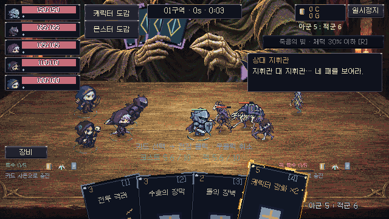

## 작업 결과

구현·실제 엔진 캡처·문서 빌드 완료. 중앙 게시 상태는publication에 기록합니다.

## 변경 내용

### 적용 내용

상대 최종 y=-157→-133으로24px 내렸습니다. 시작 위치도 y=-20→-10으로 복원했습니다. 테이블 뒤 합성·카드 동작·강화 효과는 유지합니다. 지침/기획/아트 제작 문서의 잘못된 상승 설명을 수정했습니다.

## 검증

Godot4.7.2 OpenGL3.3/GTX970 실제 전투3.23초 장면을 엔진 API로 PNG 저장. png_error=0 final_y=-133 lowered_by=24 로그와 실제 화면 확인. 환경 셰이더 캐시 쓰기 경고만 발생. 사용자 저장과 분리. node docs/build.mjs 완료. 테스트 작성·실행 없음.

## 남은 사항

최종 높이 미감 승인은 미확인. 게임 패키지 빌드·게임 배포·프로젝트 푸시 미실행. 중앙 보고 푸시/배포/HTTPS는publication에 구분합니다. 일반 교훈 추가 없음, 사용자 정정을 기존 프로젝트 높이 지침에 통합했습니다.

## 작업 시간

- 제안 시간: 약5분
- 실제로 완료된 시간: 2026-11-20 06:55:44 KST 시작, 2026-11-20 06:56:34 KST 구현·실제 촬영·문서 빌드 완료, 실측50초. 게시 완료는publication에 기록합니다.
- XERJ: 미사용 — 사용자 지침에 따라 사용하지 않았습니다.
