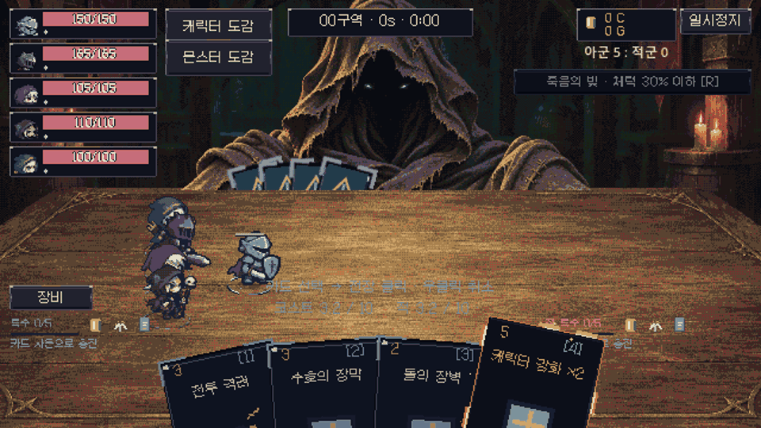

## 작업 결과

구현·Godot 컴파일·실제 GPU 전투 렌더·GIF·웹 문서 갱신 완료. 중앙 게시 상태는 publication 참조.

## 변경 내용

### 적용 내용

전투 move_free 일반 이동을 공통 move_grid로 연결했습니다. 상태 속도 중복 적용을 방지하고 격자 중심 도착 전에 재탐색으로 경유점을 건너뛰지 않게 했습니다. 전투 클릭 목적지와 도착 오차를 칸 중심에 맞췄습니다. 마을 이동 기본값은 유지합니다. 기존 전용기 직선 돌진·도약·순간이동은 별도 스킬 이동입니다. 

## 검증

Godot 4.7.2 headless editor 종료0, 스크립트 구문 오류 없음. 실제 OpenGL GTX970 전투60프레임 약4.5초 엔진 API 촬영, 현재 인게임 정지 화면 확인. user:// 로그·캐시 쓰기 및 종료 RID 경고 있음. node docs/build.mjs 완료. 테스트 작성·실행 없음.

## 남은 사항

사용자 마우스 클릭 전 구간 및 모든 스킬의 상호작용은 미확인. 패키지 빌드·게임 배포·프로젝트 푸시는 미실행. 중앙 보고 푸시·배포는 별도 기록. 검증된 공통 교훈 추가 없음.

## 작업 시간

- 제안 시간: 5~8분
- 실제로 완료된 시간: 2026-11-20 07:09:14 KST 시작. 구현·초기 렌더 07:11:40 KST까지146초. 최종 문서·중앙 게시 완료 시각은 publication에 별도 기록.
- XERJ: 미사용 — 사용자 지침에 따라 사용하지 않았습니다.
