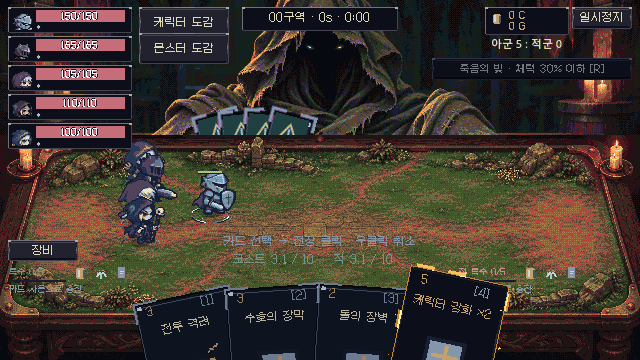

## 작업 결과

구현·ImageGen 맵 제작/연결·실제 게임 GIF·웹 문서 빌드 완료. 중앙 게시 상태는publication에 기록합니다.

## 변경 내용

### 적용 내용

상대 최종 y=-35 고정, 테이블/부대 투영의 시작 이동 제거. 테이블 상판에 신규 가로형 미니어처 전장: 양쪽 진영을 잇는 중앙 흙길/돌길·풀밭·가장자리 이끼 바위/무너진 돌담·목재/황동 테두리. 기존 팔 테이블 뒤 합성·실시간 카드·강화 FX·5:N 전투 유지. 원본/프롬프트/해시와 이전 배경 보존.

## 검증

Godot4.7.2 OpenGL3.3/GTX970 실제 루트 전투105프레임·약15fps/7초 엔진 API 직접 캡처. 맵/고정 위치 시각 확인. actual_ai_throw=true actual_refill_draw=true paused=false 확인. 강화 상태 지정 없이 기존 게임 실행. 임포트 환경의 에디터 설정/셰이더 캐시 쓰기 경고가 있으나 게임 파싱/런타임 오류 없음. node docs/build.mjs 완료. 테스트 작성·실행 없음.

## 남은 사항

맵의 바위/돌담은 배경 장식으로 새 충돌이 없으며 기존 이동·카드 장애물 판정을 유지합니다. 지형별 효과와 추가 스테이지 맵 변형은 이번 작업에 포함하지 않았습니다. 최종 높이/맵 미감 승인은 미확인. 게임 패키지 빌드·게임 배포·프로젝트 푸시 미실행. 중앙 보고 게시 상태는publication에 기록합니다. 공통 교훈 추가 없음, 최신 사용자 연출 제거/높이 요청을 프로젝트 지침에 통합했습니다.

## 작업 시간

- 제안 시간: 약10분
- 실제로 완료된 시간: 2026-11-20 07:14:43 KST 시작, 2026-11-20 07:17:06 KST 구현·이미지 제작·실제 GIF·문서 빌드 완료, 실측144초. 게시 완료는publication에 기록합니다.
- XERJ: 미사용 — 사용자 지침에 따라 사용하지 않았습니다.
