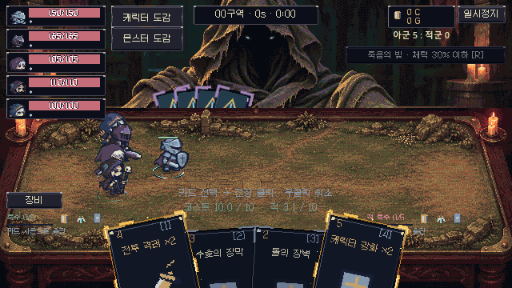

## 작업 결과

구현·PixelFX 제작/임포트·실제 게임 입력/촬영·웹 문서 빌드 완료. 중앙 게시 상태는publication에 기록합니다.

## 변경 내용

### 적용 내용

조준 중 세계 시간/AI/이동/스킬/코스트6%, UI/비행/FX는 실시간 유지. 단일 몸체 스냅·폭탄 범위 대상 금색 강조·유효/불가 범위 색상. 사용 성공 시 실제 손패 좌표부터0.62초 포물선/회전/축소 비행, 이동 단일 대상 추적, 지점 고정. 실제 효과는 도착에1회 적용하고 금빛 코어/확장 고리/18파편 PixelFX 재생. 비용/손패/특수 스택은 출발 시1회 처리. 비행 중 수량 상한 포함·도착 시 사망/설치 막힘 처리. 양측 공유.

## 검증

Godot4.7.2 OpenGL3.3/GTX970 실제 게임150프레임 녹화 중130프레임·15fps/약8.7초 GIF. 강화 전투 격려/코스트10의 촬영용 손패와 엔진 마우스 입력 이벤트 지정. 실제 조준3초 동안 world_delta=0.18, highlighted=1, CARD_ARRIVAL team=0 kind=haste 및 team=1 kind=guard effect_on_arrival=true 로그 확인. 몸체 위 조준·대상 변경·축소 비행·도착 FX 시각 확인. 전체 녹화 끝 aiming_end=false이며 paused=true는 기존 웨이브 클리어 정지입니다. PixelFX 정규화/임포트·node docs/build.mjs 완료. 환경 에디터 설정/셰이더 캐시 쓰기 경고만 발생. 테스트 작성·실행 없음. 최종 버튼/상판 입력 분리 후 동일 엔진 입력 흐름 재실행에서도 조준0.18초 및 양측 도착 발동 로그를 확인했습니다.

## 남은 사항

전체 카드 종류·폭탄 다중 대상·설치 상한·도착 전 사망·취소/모달 분기의 개별 실행은 미확인입니다. 조준 입력은 테이블 y135~315에서 받으며 화면 버튼/손패 클릭은 제외합니다. 상판 가장자리 지점 입력의 별도 조작 확인은 미실행입니다. 원본 게임 패키지 빌드·게임 배포·프로젝트 푸시 미실행. 중앙 결과 게시 상태는publication에 기록합니다. 공통 교훈 추가 없음, 사용자 확정 카드 연출을 프로젝트 지침에 통합했습니다.

## 작업 시간

- 제안 시간: 약10분
- 실제로 완료된 시간: 2026-11-20 07:20:32 KST 시작, 2026-11-20 07:25:59 KST 구현·FX 제작·실제 GIF·문서 빌드 완료, 실측327초. 게시 완료는publication에 기록합니다.
- XERJ: 미사용 — 사용자 지침에 따라 사용하지 않았습니다.
