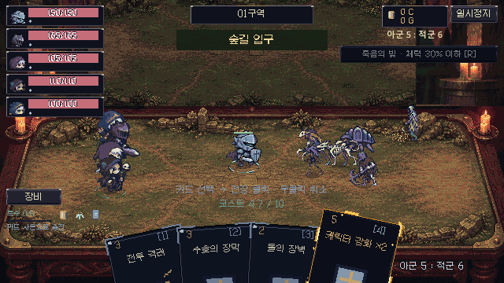

## 작업 결과

구현 및 실제 전투 화면 확인 완료.

## 변경 내용

### 적용 내용

전투 HUD 상단에 구역 번호와 보스 여부를 표시합니다. 

## 검증

Godot 4.7.2 실제 전투 실행 및 엔진 PNG 캡처에서 01구역 표시와 시간 미표시를 확인했습니다.

## 남은 사항

보스 화면과 번역은 미확인입니다. 게임 패키지 빌드와 배포는 미실행입니다. 웹 문서 원문은 갱신했으며 첫 빌드는 formation_battles.name 스키마 미등록으로 중단됐습니다.

## 작업 시간

- 제안 시간: 구현·확인 약 2분, 중앙 배포 포함 약 5분
- 실제로 완료된 시간: 2026-11-20 07:31:22 KST 시작, 07:32:00 KST 구현·촬영 완료, 약 38초.
- XERJ: 미사용 — 사용자 지침에 따라 사용하지 않았습니다.
