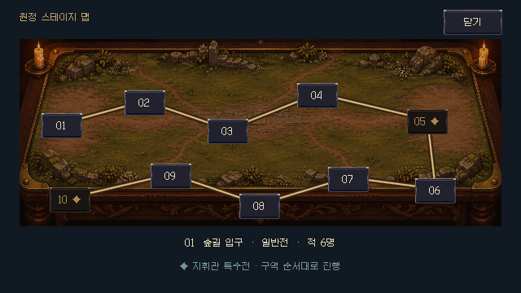
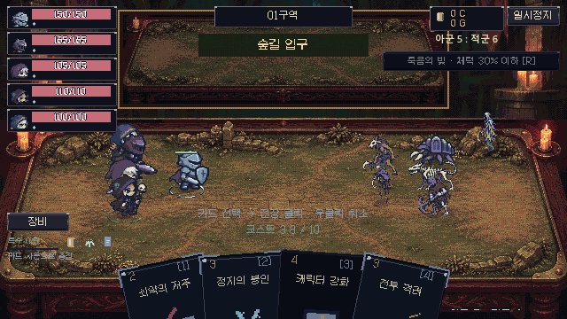

## 작업 결과

구현·실제 엔진 촬영·웹 문서 빌드 완료.

## 변경 내용

### 적용 내용

## 원정 스테이지 맵과 지휘관 특수전
마을의 스테이지 맵에서 10개 구역의 경로, 구역 이름, 적 수와 전투 유형을 확인합니다. 원정은 1~5구역 숲길과 6~10구역 황야를 순서대로 통과합니다. 5·10구역에서 적 지휘관, 적 카드 AI, 말풍선과 적 슬롯을 활성화합니다. 일반전의 맞은편에는 지역 이름과 액자형 지형 배경이 표시됩니다. 황야 상판은 기존 그림에 색조를 적용한 변형입니다.

## 검증

실제 Godot에서 마을 지도, 1구역 일반전, 5구역 특수전 화면을 확인했습니다. 5구역은 촬영을 위해 원래 구역 생성 함수를 연속 호출했습니다.

## 남은 사항

10구역 실제 도달은 미확인입니다. 구역별 별도 지형 원화·기믹은 미구현입니다. 기존 상판과 색조 변형을 사용합니다.

## 작업 시간

- 제안 시간: 약 10분
- 실제로 완료된 시간: 2026-11-20 07:30:38 KST 시작. 게시 확인 시각은 publication 기록 참조.
- XERJ: 미사용 — 사용자 지침에 따라 사용하지 않았습니다.
