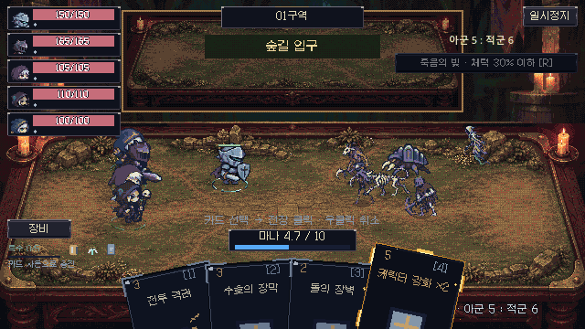

## 작업 결과

마나 게이지 구현 및 실제 전투 화면 확인 완료.

## 변경 내용

### 적용 내용

기존 양측 카드 비용과 마나 재생 규칙을 사용합니다. 손패 위 내 마나 막대와 현재량·최대량을 표시합니다. 카드와 슬롯 보상 표시 문구를 마나로 통일하고 전투 HUD 코인·골드 영역을 숨겼습니다. 

## 검증

Godot 4.7.2 실제 전투 실행 및 640×360 캡처에서 마나 4.7 / 10, 막대 채움, 코인·골드 및 상대 마나 미표시 확인. 웹 문서 빌드 완료.

## 남은 사항

카드 사용 직후 마나 차감은 별도 조작 확인 미실행. 패키지 빌드·게임 배포 미실행.

## 작업 시간

- 제안 시간: 구현·확인 약 2분, 중앙 배포 포함 약 5분
- 실제로 완료된 시간: 2026-11-20 07:36:05 KST 시작, 07:36:44 KST 실제 화면 확인, 약 39초.
- XERJ: 미사용 — 사용자 지침에 따라 사용하지 않았습니다.
