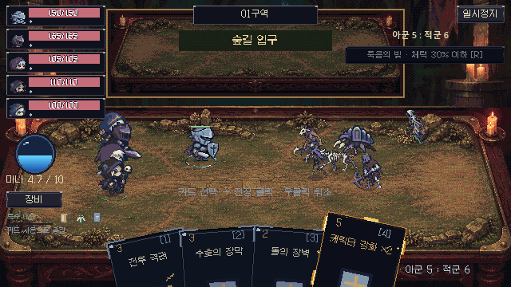

## 작업 결과

구현 및 실제 전투 화면 확인 완료.

## 변경 내용

### 적용 내용

마나 구슬은 보유 비율에 따라 아래에서부터 채워집니다. 

## 검증

Godot 4.7.2 실제 전투에서 좌측 구슬과 마나 4.7 / 10을 확인했습니다. 웹 문서 빌드를 실행했습니다.

## 남은 사항

마나 소비 조작은 미확인입니다. 게임 패키지 빌드·배포는 미실행입니다. 지침 변경 없음.

## 작업 시간

- 제안 시간: 구현·확인 약 2분, 중앙 배포 포함 약 5분
- 실제로 완료된 시간: 2026-11-20 08:34:53 KST 시작, 08:35:27 KST 실제 화면 확인, 약 34초.
- XERJ: 미사용 — 사용자 지침에 따라 사용하지 않았습니다.
