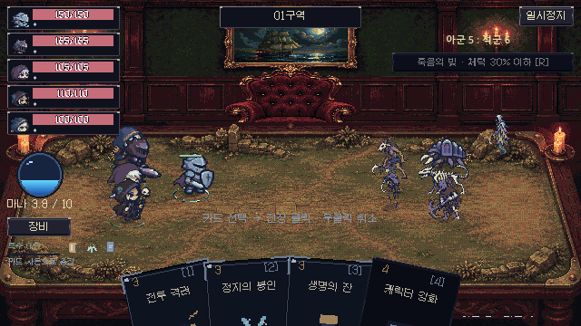

## 작업 결과

게임 연결과 실제 화면 촬영, 문서 빌드 완료.

## 변경 내용

### 적용 내용

일반전 맞은편에는 달밤 범선 그림이 걸린 벽과 테이블에 바짝 붙인 빈 1인용 벨벳 의자를 서로 다른 레이어로 배치합니다. 테이블이 의자 앞쪽을 가립니다.

## 검증

Godot 4.7.2에서 일반전 공석과 특수전 지휘관 분기를 확인했습니다.

## 남은 사항

최종 미감은 사용자 확인 대기입니다.

## 작업 시간

- 제안 시간: 약 8분
- 실제로 완료된 시간: 2026-11-20 08:36:16 KST 시작. 공개 확인은 publication 기록 참조.
- XERJ: 미사용 — 사용자 지침에 따라 사용하지 않았습니다.
