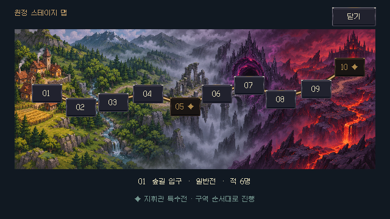

## 작업 결과

스테이지 배경 제작 및 연결, 실제 엔진 촬영과 웹 문서 빌드 완료.

## 변경 내용

### 적용 내용

원정 스테이지 맵에는 마을에서 숲과 폐허의 다리, 차원문을 지나 마계 성채로 이어지는 전용 파노라마를 배치합니다. 10개 구역 표식은 지형을 따라 왼쪽에서 오른쪽으로 진행합니다.

## 검증

Godot 4.7.2의 마을 스테이지 맵 화면에서 파노라마와 10개 표식 표시 확인.

## 남은 사항

마계는 지도상의 시각 표현입니다. 별도 마계 전투 지형은 이번 작업 범위 밖입니다.

## 작업 시간

- 제안 시간: 약 8분
- 실제로 완료된 시간: 2026-11-20 08:42:09 KST 시작. 최종 게시 확인은 publication 기록 참조.
- XERJ: 미사용 — 사용자 지침에 따라 사용하지 않았습니다.
