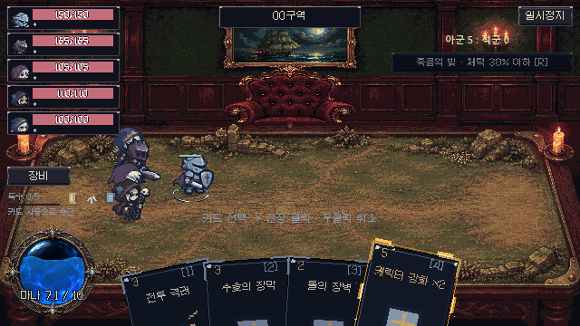

## 작업 결과

구현 및 실제 전투에서 소환과 마나 차감 확인 완료.

## 변경 내용

### 적용 내용

양측 유령 궁수 카드 도착 시 소환 성공 지점에 PixelFX Smite 광주와 바닥 파동 및 파편이 표시됩니다. 구슬 일러스트 원본을 보존하고 런타임 텍스처에 물결·굴절·기포 셰이더를 적용했습니다. 

## 검증

Godot 4.7.2 실제 GPU 전투에서 플레이어 손패에 유령 궁수를 준비한 뒤 일반 카드 사용 경로를 호출했습니다. 카드 승인, 도착 1회, 술자측 소환수 1기 및 마나 수위 변화와 광주를 확인했습니다. 웹 문서 빌드 완료.

## 남은 사항

적 AI의 소환은 별도 실행 미확인. 패키지 빌드·게임 배포 미실행. 공통 지침 추가 없음.

## 작업 시간

- 제안 시간: 8~10분
- 실제로 완료된 시간: 2026-11-20 08:52:09 KST 시작, 08:54:40 KST 실제 소환·GIF 확인, 약 2분 31초. 배포 완료 시각은 publication 참조.
- XERJ: 미사용 — 사용자 지침에 따라 사용하지 않았습니다.
