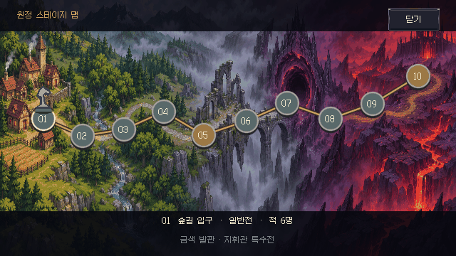

## 작업 결과

구현·실제 게임 촬영·웹 문서 빌드 완료.

## 변경 내용

### 적용 내용

스테이지 지도는 화면 전체를 덮는 파노라마 위에 원형 발판을 표시합니다. 5·10구역은 금색 발판입니다. 구역을 선택하면 돌로 깎은 체스 말이 중간 발판을 거쳐 이동하며 해당 구역 정보를 표시합니다. 지도에서의 이동은 탐색용입니다.

## 검증

Godot 4.7.2에서 실제 맵 화면을 63프레임 촬영하고 10구역 좌표 도착을 확인했습니다. 녹화는 선택 함수 호출로 재현했습니다.

## 남은 사항

실제 마우스 조작과 전체 원정 진행은 이번 촬영에서 미확인입니다.

## 작업 시간

- 제안 시간: 약 8분
- 실제로 완료된 시간: 2026-11-20 08:54:38 KST 시작. 최종 공개 확인은 publication 기록 참조.
- XERJ: 미사용 — 사용자 지침에 따라 사용하지 않았습니다.
