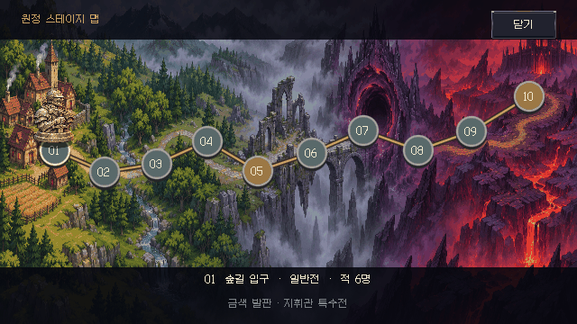

## 작업 결과

ImageGen 에셋 적용, 실제 게임 GIF 촬영과 문서 빌드 완료.

## 변경 내용

### 적용 내용

스테이지 지도 말에 투명 배경의 돌기사 흉상 일러스트를 사용합니다. 원형 받침대가 발판 위에 놓이며, 구역을 선택하면 중간 발판을 거쳐 이동합니다.

## 검증

Godot 4.7.2에서 63프레임을 촬영하고 10구역 도착을 확인했습니다. 선택 함수 호출로 촬영했습니다.

## 남은 사항

마우스 직접 조작과 최종 미감은 미확인입니다.

## 작업 시간

- 제안 시간: 약 8분
- 실제로 완료된 시간: 2026-11-20 09:03:09 KST 시작, 09:04:40 KST 촬영과 문서 갱신.
- XERJ: 미사용 — 사용자 지침에 따라 사용하지 않았습니다.
