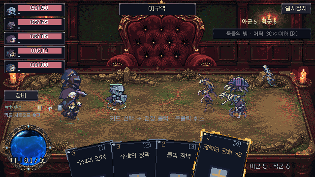

## 작업 결과

구현 및 실제 전투 조준·대상 전환·취소 시각 확인 완료.

## 변경 내용

### 적용 내용

6% 조준 중 전장 위 어둡기와 밝은 범위·유닛 윤곽을 합성합니다. 설치 상한·장애물·UI 입력 영역 조건을 실제 사용과 공유합니다. 의자 원본 비율에 맞춰 키우고 상판 뒤로 배치했습니다. 

## 검증

Godot 4.7.2 실제 전투에서 수호의 장막을 선택하고 서로 다른 아군 둘에 조준한 뒤 Esc를 입력했습니다. 두 조준 지점에서 대상 1명 및 취소 후 조준 비활성 확인. 웹 문서 빌드 완료.

## 남은 사항

다른 카드의 범위 판정은 소스 확인이며 개별 조작 미확인. 게임 패키지 빌드·배포 미실행. 공통 지침 추가 없음.

## 작업 시간

- 제안 시간: 8~10분
- 실제로 완료된 시간: 2026-11-20 09:05:12 KST 시작, 09:07:19 KST 구현·실제 장면 확인. 게시 시각은 publication 참조.
- XERJ: 미사용 — 사용자 지침에 따라 사용하지 않았습니다.
