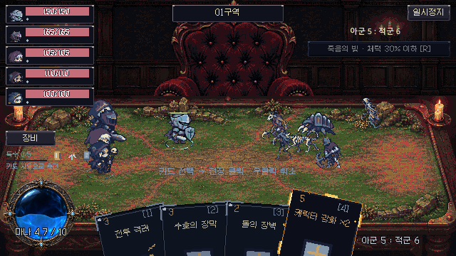

## 작업 결과

구현 및 실제 전투 화면 확인 완료.

## 변경 내용

### 적용 내용

배경과 공석 의자 렌더에 어두운 색조를 적용했습니다. 

## 검증

Godot 4.7.2 전투 화면을 엔진 API로 촬영해 벽, 의자, 상판의 대비를 확인했습니다. 웹 문서 빌드 완료.

## 남은 사항

지휘관이 있는 구역의 배경은 소스 확인이며 해당 화면은 미확인입니다. 게임 패키지 빌드와 배포는 미실행입니다. 지침 변경 없음.

## 작업 시간

- 제안 시간: 구현·캡처 약 2분, 중앙 배포 포함 약 5분
- 실제로 완료된 시간: 2026-11-20 09:17:39 KST 시작, 09:18:17 KST 구현·캡처 완료.
- XERJ: 미사용 — 사용자 지침에 따라 사용하지 않았습니다.
