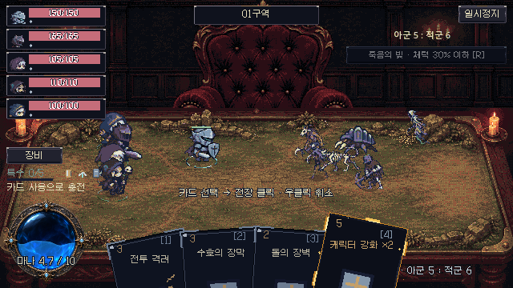

## 작업 결과

구현 및 실제 전투 화면 확인 완료.

## 변경 내용

### 적용 내용

Galmuri11을 유지하고 슬롯 글자를 기본 크기로 표시합니다. 카드의 회전과 글자의 회전을 상쇄하고 조작 안내에 밝은 글자와 어두운 외곽선을 적용합니다. 

## 검증

Godot 4.7.2 실제 전투에서 슬롯과 카드의 글자 및 조작 안내 표시를 확인했습니다. 웹 문서 빌드 완료.

## 남은 사항

다른 창 크기와 언어는 미확인입니다. 업데이트 로컬 최신 2026-11-20-003, 원격 조회 결과는 공개 확인 기록 참조. 게임 패키지 빌드와 배포 미실행. 지침 변경 없음.

## 작업 시간

- 제안 시간: 구현·캡처 약 2분, 중앙 배포 포함 약 5분
- 실제로 완료된 시간: 2026-11-20 09:25:57 KST 시작, 09:26:56 KST 구현·캡처 완료.
- XERJ: 미사용 — 사용자 지침에 따라 사용하지 않았습니다.
