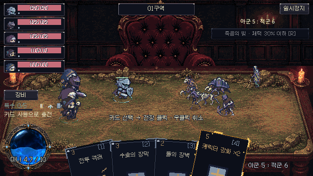

## 작업 결과

구현 및 실제 전투 화면 확인 완료.

## 변경 내용

### 적용 내용

카드 글자의 역회전을 제거했습니다. 슬롯 글자 크기와 조작 가이드 외곽선을 유지했습니다. 

## 검증

Godot 4.7.2 전투 화면에서 카드와 글자가 같이 기울어지는 것을 확인했습니다. 웹 문서 빌드 완료.

## 남은 사항

호버 전환은 미확인입니다. 게임 패키지 빌드·배포 미실행. 공통 지침 변경 없음.

## 작업 시간

- 제안 시간: 구현·캡처 약 2분, 중앙 배포 포함 약 5분
- 실제로 완료된 시간: 2026-11-20 09:31:28 KST 시작, 09:32:05 KST 구현·화면 확인.
- XERJ: 미사용 — 사용자 지침에 따라 사용하지 않았습니다.
