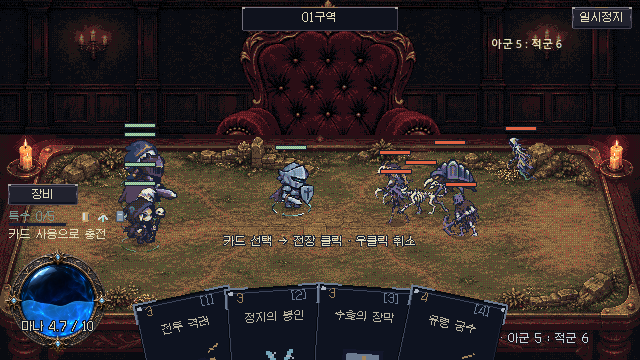

## 작업 결과

구현·Godot 실제 실행·화면 캡처·웹 문서 빌드 완료. 중앙 게시 상태 별도 기록.

## 변경 내용

### 적용 내용

좌상단 플레이어·동료 체력 HUD와 성급 패널 제거. 아군·적·소환수의 생존 시 머리 위 체력바 상시 표시. 죽음의 빚 생성·피해 보정·추심·정산 연결 제거. R·E 입력 차단 및 플레이어 E 전용기 수동·AI 발동 차단. 자동 기본 공격·자동 스킬·실시간 카드 유지. 현재 정책과 실제 캡처를 웹 문서에 반영했습니다.

## 검증

Godot 4.7.2 OpenGL 실제 루트 게임 실행 종료0, data_errors=[] 및 아군5·적6 전투 확인. 엔진 API 캡처640×360 저장 성공. 좌상단 체력 패널 부재와 머리 위 체력바를 이미지로 확인. R·E 제거와 빚의 피해·정산 경로 제거는 소스로 확인. 테스트 작성·실행 없음. 기존 user:// 로그·셰이더 캐시 쓰기 및 종료 RID 경고 있음.

## 남은 사항

키보드 직접 입력 상호작용은 미확인. 패키지 빌드·프로젝트 푸시·게임 배포 미실행. SkillEvaluator는 스킬 변경이 없어 비대상이며 앱 제어는 기존 Godot CLI·공식 렌더 API로 충족. 공통 교훈 추가 없음. 업데이트 원격 조회 실패, 알려진 최신 ID 2026-11-20-003 기준 적용.

## 작업 시간

- 제안 시간: 10분 이내
- 실제로 완료된 시간: 2026-11-20 09:34:03 KST 시작, 09:36:00 KST 실제 화면 확인 완료(1분57초). 문서·중앙 게시 완료 시각은 publication 참조.
- XERJ: 미사용 — 사용자 지침에 따라 사용하지 않았습니다.
