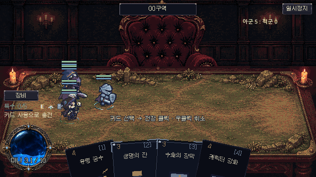

## 작업 결과

구현·Godot 실제 전투 실행·180프레임 GIF·데이터 카탈로그·웹 문서 빌드 완료. 중앙 보고 게시 상태 별도 기록.

## 변경 내용

### 적용 내용

공통 actor_mana로 최대100을 고정하고 시작100·초당5 회복·시전당30 소모를 연결했습니다. 클래스 스킬·캐릭터 고유 능력·몬스터 능력·보스 시전에 적용하며 부족하면 시전을 차단합니다. 일반 공격·카드 자원과 분리합니다. 아군 체력바 아래 파란 마나바를 표시하고 적은 표시하지 않습니다. 캐릭터별 소모·회복 데이터와 DDT 하위 시트, 관계도와 실제 동작 GIF를 문서에 반영했습니다.

## 검증

Godot4.7.2 실제 OpenGL 전투11.05초, 캡처180프레임/15fps를 GIF로 기록. 총 마나 소모10회 중 적 내부 소모5회. 아군 현재 마나 [74.4,100,100,79.5,90.5], 적 마나 최종100(회복 후). 실제 화면에서 아군 파란 바와 적 마나바 부재 확인. 최대100 고정·부족 시 차단·일시정지/조준 슬로우의 공통 전투시계 연결은 소스로 확인. 데이터 카탈로그와 웹 빌드 성공. 테스트 작성·회귀 테스트 없음. 기존 user:// 로그/셰이더 캐시 쓰기와 종료 텍스처 경고 유지.

## 남은 사항

잔여 마나 부족·개별 사망/부활·보스 시전의 별도 실행은 미확인. 패키지 빌드·프로젝트 푸시·게임 배포 미실행. SkillEvaluator는 스킬 변경이 없어 비대상. CLI-Anything 기준은 기존 Godot CLI·공식 렌더 API 재사용으로 충족. 최대100 고정은 사용자 확정 정책으로 프로젝트 지침에 반영. 원격 업데이트 확인 상태는 publication에 기록.

## 작업 시간

- 제안 시간: 10분 이내
- 실제로 완료된 시간: 2026-11-20 09:39:42 KST 시작, 09:42:23 KST 최대100 적용 실제 동작 촬영과 문서 빌드 완료(2분41초). 중앙 게시 포함 완료 시각은 publication 참조.
- XERJ: 미사용 — 사용자 지침에 따라 사용하지 않았습니다.
