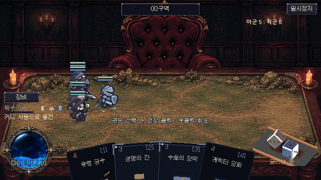

## 작업 결과

구현·실제 Godot 전투 실행·180프레임 GIF·데이터 및 웹 문서 빌드 완료. 공개 미디어 접근 확인 전까지 전체 완료로 분류하지 않습니다.

## 변경 내용

### 적용 내용

기존 사전형 전투 배우를 유지하며 AStarGrid2D·칸 점유·경로 재계산을 제거했습니다. 플레이어·동료·적·소환수의 이동을 연속 좌표로 통일하고0.18 이하 소구간 이동·원형 접촉·무게 비율 밀림·최종 반복 분리를 구현했습니다. 테이블 경계와 카드 장애물에도 반경을 적용합니다. 마을 클릭 목표도 연속 좌표입니다. classes/monsters의 body_radius·body_mass를 DDT 하위 데이터와 카탈로그에 반영했습니다. 기본 아군 반경0.9/무게1, 일반 적1/1.3, 보스1.8/12이며 큰 배우는 독립 조절합니다. Godot RigidBody2D 노드 전환이 아닌 원형 몸체 풀이입니다.

## 검증

Godot4.7.2 OpenGL 실제 전투11.05초·180프레임/15fps 촬영, 종료0. 마지막 생존 몸체11개·접촉 보정672회·최대 겹침0.000082755 월드 단위(화면0.002px 미만). 연속 좌표 클릭 목표(-2.37,1.23) 이동과 AI 교전을 기록했습니다. GIF180프레임 디코딩·반복과 이동 영역 변화 확인. 런타임에서 AStar·move_grid·칸 점유 참조 제거를 검색 확인. 데이터 카탈로그·웹 빌드 성공. 테스트 작성·실행 없음. 기존 로그·캐시 권한 및 종료 텍스처 경고 유지.

## 남은 사항

대형 몬스터를 추가한 실제 교전·극단적 밀집/장애물 끼임·마을 이동은 별도 실행 미확인. 전역 미로 최단 경로 탐색을 제공하지 않으며 좁은 막힘에서는 지역 우회를 사용합니다. 시각적 앞뒤 가림과 발밑 물리 겹침을 구분합니다. 패키지 빌드·프로젝트 푸시·게임 배포 미실행. SkillEvaluator는 스킬 변경이 없어 비대상. CLI-Anything 기준은 기존 Godot CLI·렌더 API로 충족. 정책은 프로젝트 지침에 반영, 공통 교훈 추가 없음. 공개 게시 상태와 업데이트 확인은 publication 참조.

## 작업 시간

- 제안 시간: 10분 이내
- 실제로 완료된 시간: 2026-11-20 09:54:38 KST 시작. 09:58:45 KST 최종 실제 전투 확인(4분7초). 중앙 게시 포함 완료 시각은 publication 참조.
- XERJ: 미사용 — 사용자 지침에 따라 사용하지 않았습니다.
