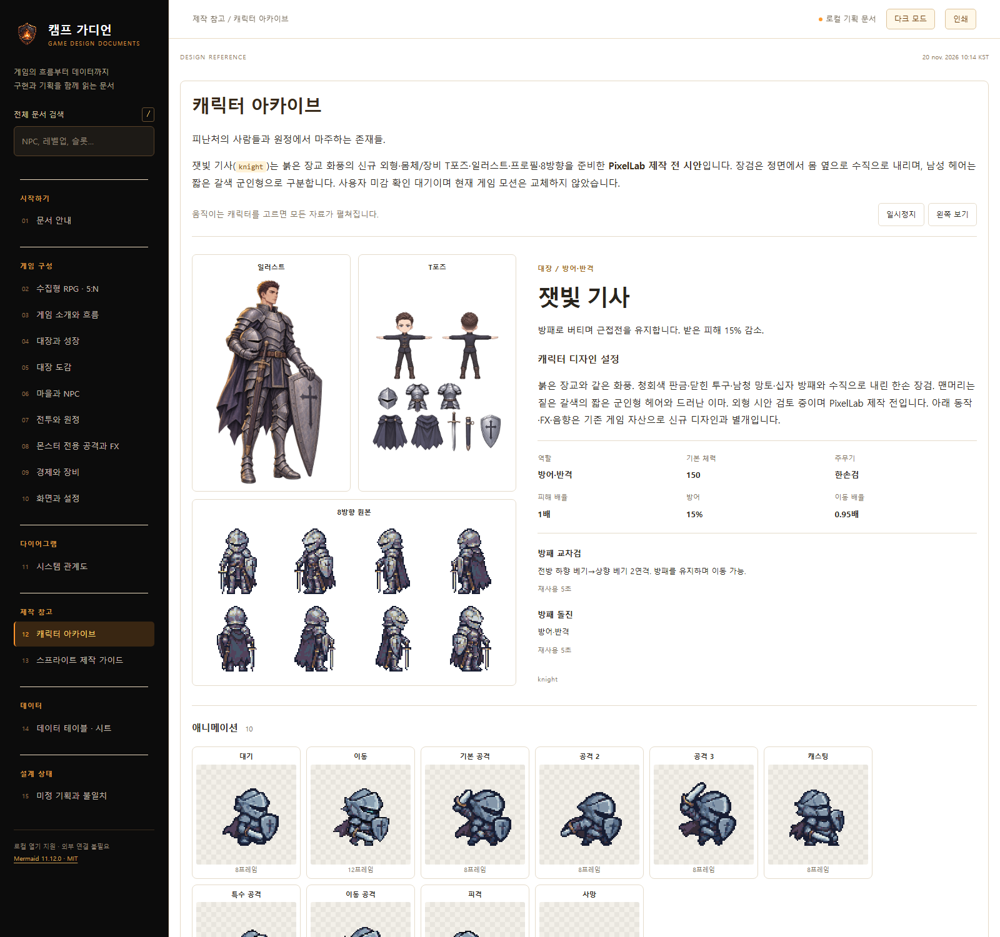
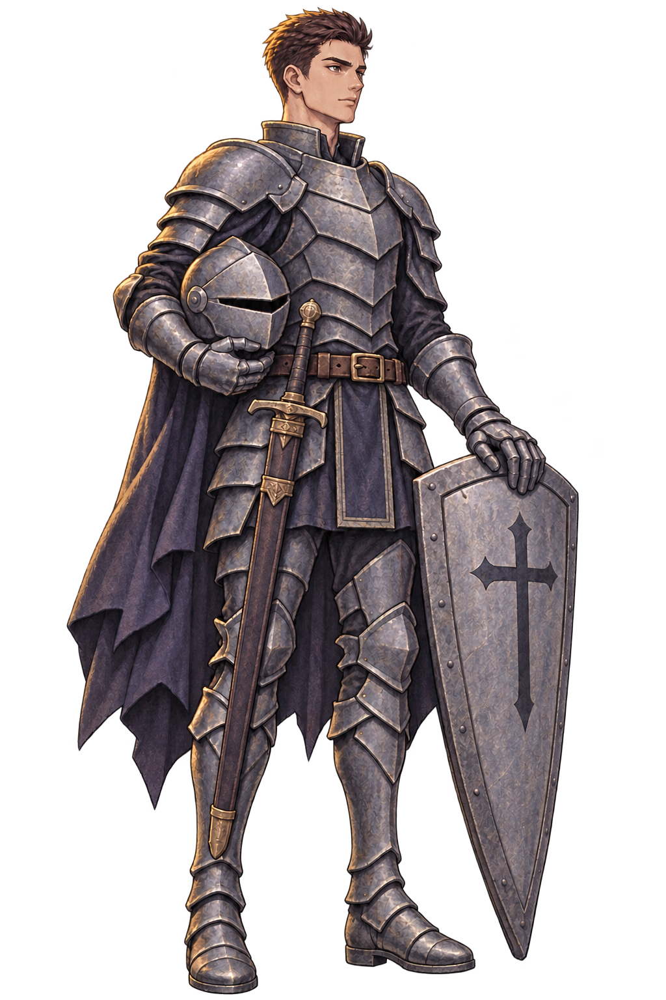
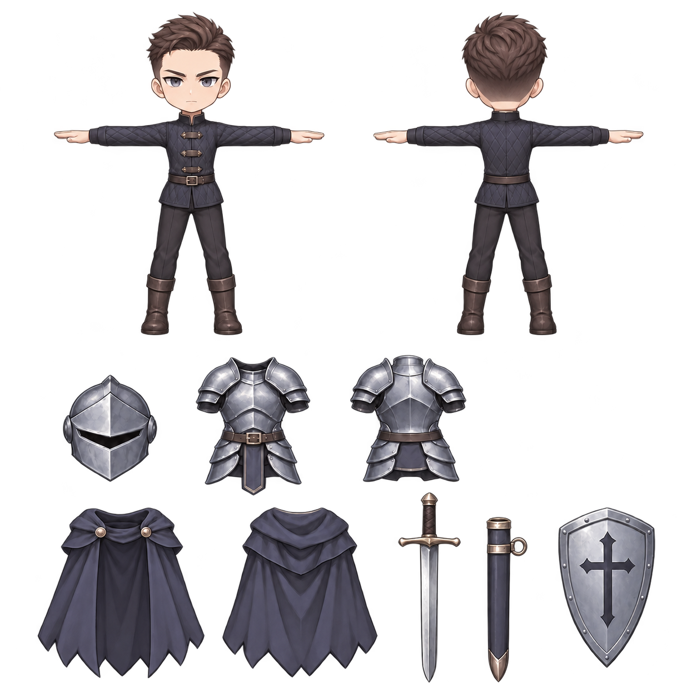
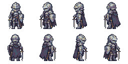

## 작업 결과

자산 저장·문서 반영·정적 화면 확인 완료. PixelLab0회, 게임 모션 미교체. 사용자 미감 승인은 대기입니다.

## 변경 내용

### 적용 내용

잿빛 기사 현행 ID knight를 사용했습니다. 장교의 실제 선택본 화풍을 참조해 청회색 판금·닫힌 투구·남청 망토·십자 방패를 유지했습니다. 검은 몸 옆에서 칼끝이 아래인 수직 장검으로, 맨머리는 드러난 이마와 짧은 갈색 군인형 헤어로 보정했습니다. 이름별 폴더의 최신5장·고해상도 원본·PixelLab대기참조128·제작기록ZIP·해시를 저장했습니다. 이전 연구20폴더364파일과 이번 폐기 생성시안5개 삭제, 폐기 부하를 아카이브 현행 목록에서 제거했습니다. 공통 제작 가이드에 장교 선택본 화풍과 현행 대장 대상 선택을 반영했습니다.

## 검증

docs/index.html의 제작 가이드 전문과 장교 아카이브·실제 이미지 확인. ImageGen원본5방향을 최근접64칸으로 픽셀화하고 프로젝트 소유 정규화 적용. 256×128·4열2행·3방향 정확한 좌우반전 확인. 128파생본은64칸 중앙32패딩. 원본PNG알파 존재, 각 산출물파일·SHA256확인. node docs/build.mjs:15페이지·720이미지 성공. Chrome자체headless로 현재 docs/index.html?character=knight#sprite-browser1600×1500PNG저장 후 내용 확인. 신규 디자인은 정적이므로GIF가 아닌스크린샷으로 보고. 테스트 작성·실행 없음.

## 남은 사항

PixelLab제작·게임모션교체·신규전용FX/사운드는 요청 범위 밖으로 미실행. 공용리그장착 미완료, 최종 미감승인 대기. 현행게임이 사용하는기존클래스시트·장교정본 및 공급자원본은 보존했으며 이삭제를모든과거파일의전수삭제로표현하지않습니다. 중앙푸시·배포·HTTPS확인은publication에별도기록. 시작업데이트원격조회실패:알려진최신2026-11-20-008적용, 원격최신미확인. SkillEvaluator는스킬변경이없어비대상, CLI-Anything은앞서기존CLI조회연결실패후공식ImageGen·Chrome캡처재사용.

## 작업 시간

- 제안 시간: 10분 이내
- 실제로 완료된 시간: 2026-11-20 10:07:59 KST 시작, 자산·문서·캡처 2026-11-20T01:15:42.312Z (463초). 게시완료시각은publication기록.
- XERJ: 미사용 — 사용자 지침에 따라 사용하지 않았습니다.
