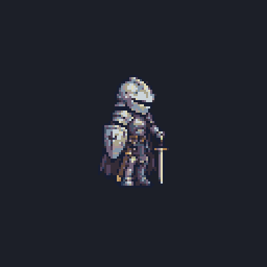

## 작업 결과

PixelLab 생성7종·원본저장·개별GIF·문서반영 완료. 게임미교체·미감검토중. 최종계정잔여0회,USD0.

## 변경 내용

### 적용 내용

공식 animate-with-text-v3사용, 모션당1generation. Trial동시1작업제한에맞춰순차생성. 공통대기5시/동작전방3시명시, 장검·방패·갑옷유지프롬프트사용. PNG원본과공급자응답·프롬프트·해시를제작기록ZIP에보존하고일체형시트·motions.json·개별GIF미리보기생성. PixelLab출력정규화없음. 아래는PixelLab실제생성프레임을재생한자산미리보기이며인게임캡처가아닙니다.

### 대기

### 이동

### 기본 공격

### 방패 돌진 준비·강타

### 캐스팅

### 피격

### 사망

## 검증

공식balance잔여7회/USD0확인후제작. 완료모션별128×128·5프레임·프레임내용상이·GIF5프레임재생·원본PNG바이트보존/ZIP해시대조. 공급자no_background=true로알파확인. [{"motion":"attack","frames":5,"distinctFrames":5},{"motion":"cast","frames":5,"distinctFrames":5},{"motion":"death","frames":5,"distinctFrames":5},{"motion":"hurt","frames":5,"distinctFrames":5},{"motion":"idle","frames":5,"distinctFrames":5},{"motion":"special","frames":5,"distinctFrames":5},{"motion":"walk","frames":5,"distinctFrames":5}] node docs/build.mjs완료. 테스트작성/실행없음. 실제게임런타임검증미실행.

## 남은 사항

실제 프레임 관찰: 기본 공격은 하향 베기보다 전방 찌르기에 가깝고 회수가 충분하지 않습니다. 특수기는 방패 강타보다 검을 앞으로 내미는 모습으로 보여 의도 일치 보정이 필요합니다. 대기는 검 움직임이 커지고 캐스팅/피격의 구분도 더 명확해야 합니다. 짧은4생성프레임초안입니다. 반복접합·검/방패그립·방향·사망종점의사용자품질확인이필요합니다. 현재게임시트교체·판정/FX/사운드연결·리그분리는미실행이며Pixellab완료와게임연결완료를구분합니다. 재생성은이번무료예산안에서추가실행하지않았습니다. 중앙배포와모든개별GIF의공개GET/재생검증은publication기록.

## 작업 시간

- 제안 시간: 제작10분 예상, 중앙배포대기별도
- 실제로 완료된 시간: 2026-11-20 10:30:06 KST 시작. 생성·저장·문서완료 2026-11-20T01:38:09.193Z (483초). 중앙배포완료시각은publication기록.
- XERJ: 미사용 — 사용자 지침에 따라 미사용.
