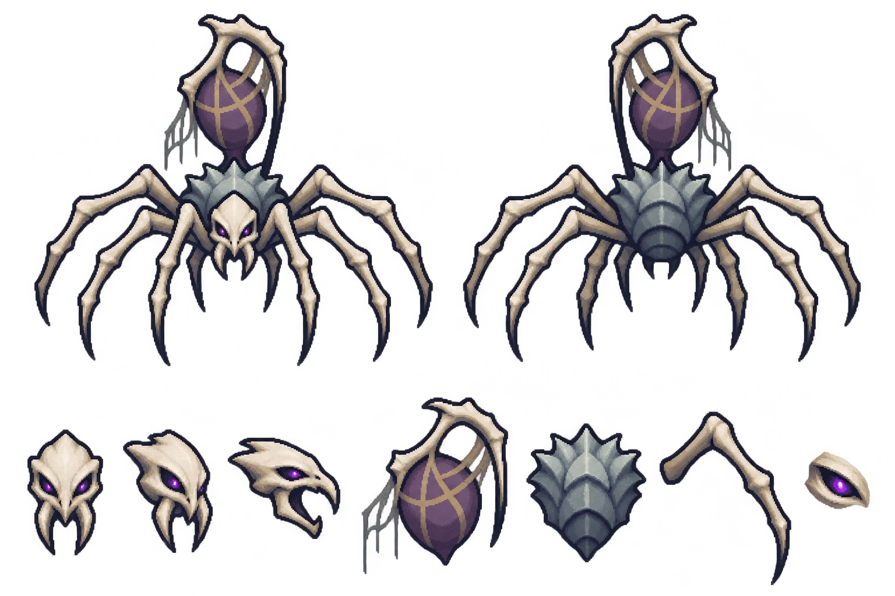

## 작업 결과

무덤 거미줄잡이의 PixelLab 투입 전 제작 묶음을 저장했습니다. 개별 시안 검토 대기이며 전체 캐릭터/몬스터 최신화는 진행 중입니다.

## 변경 내용

### 적용 내용

Pale grave SPIDER with eight long thin hooked legs, narrow ivory skull-shaped head, hanging web spinner organ raised behind back, tiny violet eyes. Wide radial leg silhouette, clearly a spider and NOT a beetle.

일러스트 자세: Rearing ambush with front legs curled high, spinneret angled toward viewer, mandibles exposed

일러스트·프로필·몸체 정후면·분리 장비·방향 원본·128 패딩본·대기 참조·출처/프롬프트/해시를 art/characters/무덤거미줄잡이에 저장했습니다. 문서 아카이브도 같은 시안으로 연결했습니다. 게임 모션·공격·FX는 교체하지 않았습니다.

### 대화 기록
사용자 요청: 누락된 캐릭터/몬스터를 PixelLab 전 단계까지 최신화하고 한 종씩 보고. 몬스터 일러스트는 다양한 자세로 위협적이고 무섭게 제작.

거미형 정후면 몸체 기준도와 머리·등갑·다리·거미줄 기관 생체 상세입니다. 전갈 꼬리나 인간형 팔다리를 추가하지 않았습니다. 상세는 실제 탈착 장비나 리그 파츠가 아닙니다.

## 검증

실제 ImageGen 출력의 외형·T포즈 정후면·분리 장비·5방향을 확인했습니다. 256×128 전체 시트·64칸·NE/NW, E/W, SE/SW 바이트 단위 정확한 반전과32px 중앙 패딩을 확인했습니다. PixelLab 호출0회. 선택한 픽셀 파생본만 tools/normalize-art.mjs 적용. node docs/build.mjs 통과(15페이지). WebP 저장 후 재열기 확인. 게임 실행/회귀 테스트는 범위 밖으로 미실행.

## 남은 사항

최종 사용자 미감 승인 대기. PixelLab/리그 파츠/모션·FX·음향 신규 제작과 게임 연결은 이번 요청 범위 밖입니다. 전체 최신화의 나머지 대상은 진행 중입니다. SkillEvaluator는 스킬 변경이 없어 비대상, CLI-Anything은 GUI 조작 없이 ImageGen 및 기존 파일 API를 사용하여 비대상. 지침 추가 변경 없음: 기존 제작 규칙 재사용. 업데이트 원격 확인 latest2026-11-20-011, 새 채팅 지침의 개별 시안 직접 표시 적용.

## 작업 시간

- 제안 시간: 전량 제작3~6시간. 종별 제작과 저장·문서 연결·게시를 순서대로 수행.
- 실제로 완료된 시간: 이 종 제작·정리 2.7분. 시작 2026-11-20T11:31:12.437000+09:00, 제작 저장 2026-11-20T11:33:54.955788+09:00 (Asia/Seoul). 푸시·배포 대기는 별도 기록.
- XERJ: 미사용 — 지침에 따라 사용하지 않음. 파일 검색 rg, 기존 이미지와 데이터 대조.
