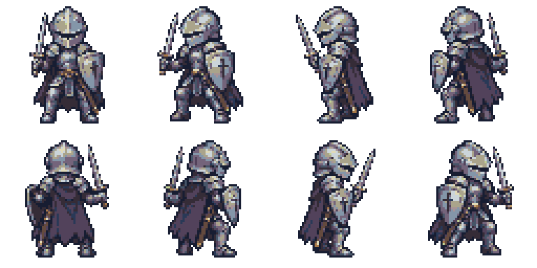
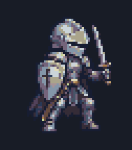
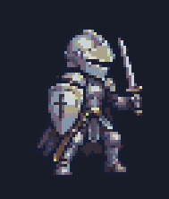
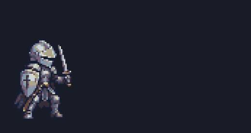
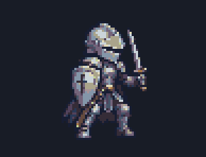
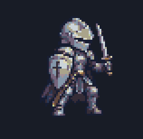
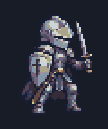
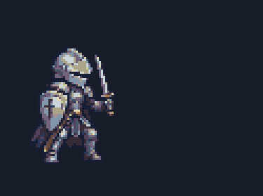

## 작업 결과

방향 시트·7종 생성·원본/해시 보존·개별 GIF·문서 반영 완료. 게임 연결과 사용자 미감 승인은 별도 미완료입니다.

## 변경 내용

### 적용 내용

검을 바닥에 짚는 자세를 폐기하고 칼을 손으로 들어 준비하는5원본을 ImageGen으로 제작했습니다.64칸 픽셀화·정확한3반전·256×128 시트와128칸 중앙패딩을 저장했습니다.

PixelLab PixMiniMax에 검손/방패팔 분리 고정과 대기5시·동작전방3시를 명시했습니다. 기본공격은 넓은256칸의 전진 횡베기→역베기→내려베기3콤보, 특수기는 사용자 선택대로 방패 강타→짧은 전진 중량 베기3연속입니다. 강한 피격은 충격·휘청임·회복, 사망은 무릎 붕괴·가로축 쓰러짐·누운 종점을 구분했습니다.

아래는 실제 PixelLab 생성 프레임의 개별 GIF입니다. 원본 PNG/팔레트/알파는 정규화하지 않았습니다. 미리보기는 전체 프레임의 공통 알파 영역을 같은 사각형으로 잘라3배 최근접 표시하며 원본은128/256칸 그대로 보존합니다. 인게임 캡처가 아닙니다.

### 대기 · 17장

### 걷기 · 17장

### 전진 3콤보 · 33장

### 강한 피격 · 25장

### 사망 · 25장

### 캐스팅 · 17장

### 방패 강타·전진 중량 3연격 · 33장

## 검증

실제 생성 장수/캔버스: idle:17장/128칸, walk:17장/128칸, attack:33장/256칸, hurt:25장/128칸, death:25장/128칸, cast:17장/128칸, special:33장/256칸. 각 GIF 여러 고유 프레임·파일 재생/지속 시간·공급자 PNG 원본 ZIP SHA256을 대조했습니다. 주요 자세 관찰: {"attack":"33장 주요 자세에서 몸통 회전·전진 디딤·넓은 검 궤적과 검/방패의 별도 팔을 관찰했습니다. 흰 검 잔상은 공급자 원본에 포함됩니다.","idle":"17장. 검끝이 공중에 있고 검을 손에 든 가드 자세의 호흡·체중 변화를 확인했습니다.","walk":"17장. 교차하는 다리와 무릎 들림·몸의 상하 움직임, 검과 방패 유지가 보입니다.","death":"25장. 가로축으로 뒤로 넘어져 옆으로 누운 종점이 이어집니다.","cast":"17장. 방패를 전면에 두고 검을 어깨 뒤로 당기는 준비 자세와 복귀를 확인했습니다.","hurt":"첫21장 초안은 약한 반동과 붉은 빔으로 미채택 보관했습니다. 재생성25장에서는 빔 없이 상체/머리가 크게 뒤로 젖혀지고 한 발 물러나는 반동과 가드 복귀가 보입니다.","special":"33장. 초반12프레임을 추가 대조해 검을 뒤에 둔 별도 방패팔의 전방 강타(7프레임)와 반동을 확인했습니다. 이후 검 연격과 큰 내려베기·가드 복귀를 관찰했습니다. 흰 잔상은 원본 포함입니다."}. node docs/build.mjs 성공. 테스트 작성/실행 없음. 구독 생성분 2000→1975 (25사용), USD 크레딧 결제 없음.

## 남은 사항

프레임 중 이동은 생성 이미지 안의 동작입니다. 실제 게임 루트 이동·콤보 판정·스킬 수치·신규PixelFX/사운드 연결은 아직 하지 않았습니다. 공급자가 그린 흰 검 잔상은 PixelLab 원본에 포함된 것이며 별도 PixelFX 제작으로 기록하지 않습니다. 전체 연속 재생의 미감·손/장비 해부학적 완전성은 사용자 확인 대기입니다. 이전 잘못된 방향·4프레임 초안은 현행에서 교체하고 제작기록 ZIP에 이전 선택본으로 구분했습니다. 새 공통 공격2~5콤보·무기손 고정 규칙을 프로젝트 지침과 웹 제작 가이드에 통합했습니다. 중앙 배포/개별 GIF HTTPS 접근 확인은publication에 기록합니다.

## 작업 시간

- 제안 시간: 생성 대기 포함25~35분, 중앙 배포 대기 별도
- 실제로 완료된 시간: 2026-11-20 14:01:19 KST 시작. 제작·저장·문서 완료 2026-11-20T05:24:46.247Z (1407초). 중앙 배포 완료 시각은publication에 기록합니다.
- XERJ: 미사용 — 사용자 지침에 따라 미사용.
