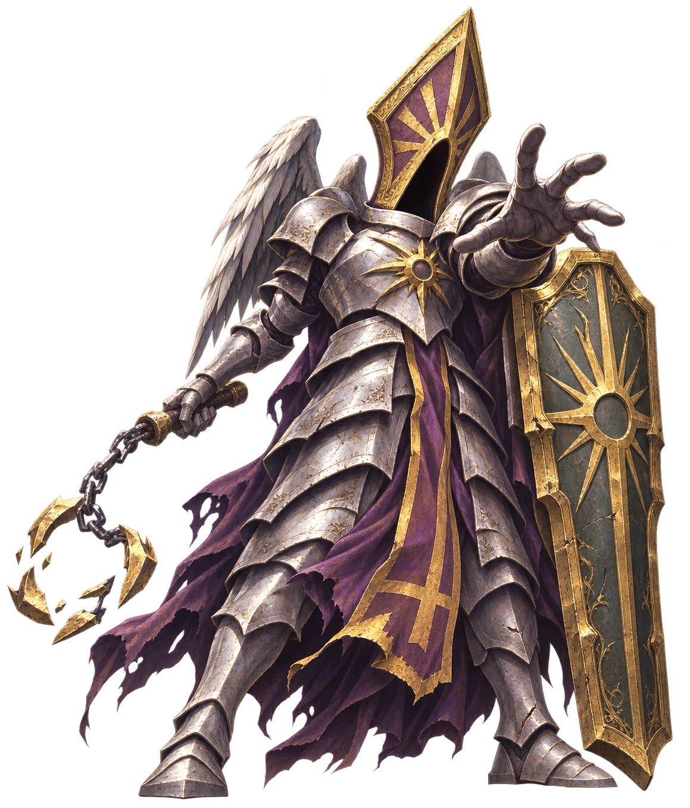
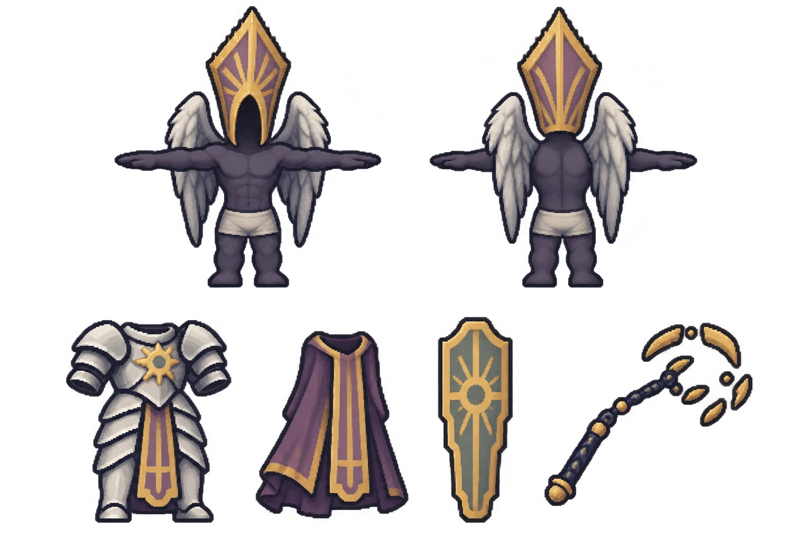
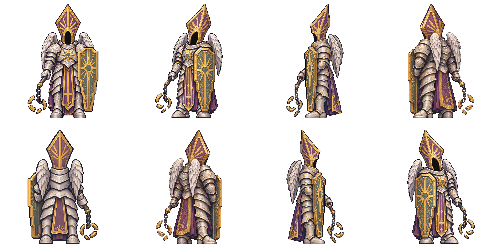

## 작업 결과

방향당512×512·전체2048×1024,5신규 원본+3정확한 반전을 모든 캐릭터·몬스터·보스에 적용했습니다. 아래는 현재 저장·확인된 광신의 집정관 제작 예제이며 전체76종 완료를 뜻하지 않습니다.

## 변경 내용

### 적용 내용

AGENTS.md와 docs/character-production.md의 최상위 제작 기준을512칸으로 확정했습니다. 아카이브 문서와 제작 인벤토리76종 모두 같은 규격을 요청합니다. 신규 패키지는 개별512용 원본5장 없이는 저장을 거부하며2048×1024 시트와512 대기 참조를 출력합니다. 기존64칸 단순 확대는 인정하지 않습니다. 기존 확정 외형·원본·사용자 편집본·런타임 모션·충돌·표시 크기는 보존합니다. 중앙 프로젝트 지침에도 같은 최상위 기준을 추가합니다.

## 검증

소스·지침·인벤토리 대조 및 node docs/build.mjs 통과(15페이지). 기존512 결과 시트의2048×1024와 정확한 반전은 종별 제작에서 확인했습니다. 신규 패키지 분기는 아직 실제 신규 캐릭터로 실행하지 않았으므로 미확인입니다. 테스트·게임 실행은 요청 범위 밖으로 미실행. 중앙 지침은 원격 최신본에512절만 병합하여 다른 변경을 보존합니다.

## 남은 사항

전체 아트 최신화 진행 중:512 저장9종,67종 방향 재제작 또는 전체 제작 잔여. 사용자 미감 승인 대기. PixelLab 호출0회. SkillEvaluator·CLI-Anything은 해당 없음. 중앙 지침 변경은 프로젝트 전용이며 전역 스킬·전역 지침은 수정하지 않았습니다. 최신 사용자 지침에 따라 채팅은 로컬 원본 직접 첨부, 중앙 미디어는HTTPS 확인. 모바일 첨부 접근은 미확인.

## 작업 시간

- 제안 시간: 지침·생성 경로 반영 약10분. 전체76종512 제작 잔여6~10시간으로 재산정(종당 실측5~8분+보정·게시).
- 실제로 완료된 시간: 512 전량 요청 수신 약2026-11-20 14:23 KST부터 기록. 저장 시각 2026-11-20T05:27:05.751Z; 중앙 푸시·배포 대기는 별도. 전체 제작은 미완료.
- XERJ: 미사용 — 지침에 따라 사용하지 않음. 파일 검색 rg, 기존 이미지와 데이터 대조.
