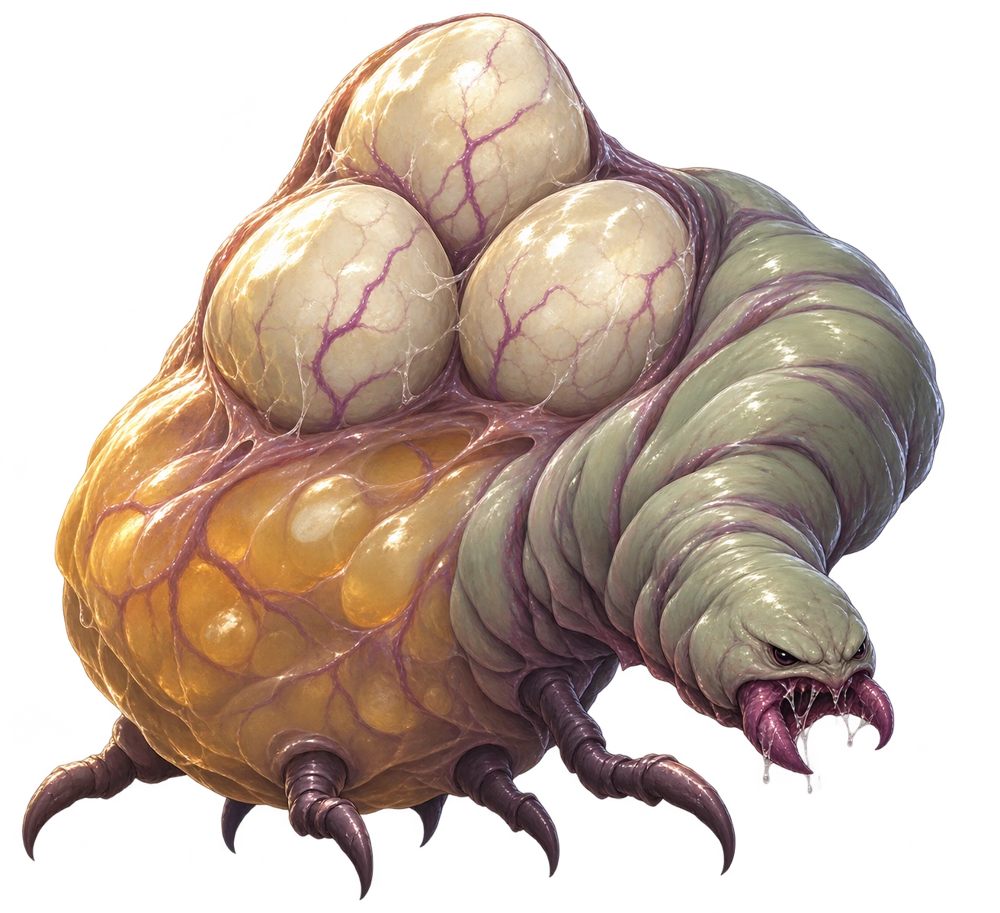
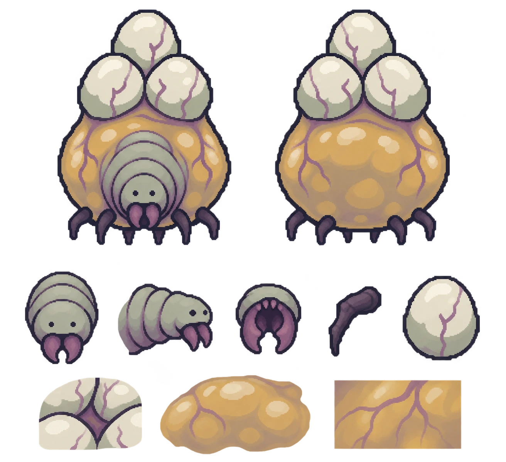
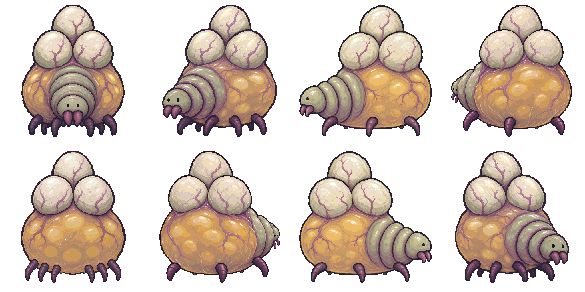

## 작업 결과

알집 운반체의5방향을 각각 새로 그려512칸8방향 시트로 재구성했습니다. 기존64칸 확대가 아닙니다. 일러스트·T포즈는 기존 선택본을 유지합니다. 전체 최신화는 진행 중입니다.

## 변경 내용

### 적용 내용

Bloated egg-bearing centipede grub, translucent ochre abdomen carrying a clustered backpack of THREE large ivory eggs, tiny dark forelegs and short blunt head. Pear-shaped lumpy silhouette, no beetle shell.

일러스트 자세: Protective threatening coil around its existing carried egg masses, front claws spread and body arched

일러스트·프로필·몸체 정후면·분리 장비·512 방향 원본·512 대기 참조·출처/프롬프트/해시를 art/characters/알집운반체에 저장했습니다. 문서 아카이브도 같은 시안으로 연결했습니다. 게임 모션·공격·FX는 교체하지 않았습니다.

### 대화 기록
사용자 요청: 누락된 캐릭터/몬스터를 PixelLab 전 단계까지 최신화하고 한 종씩 보고. 몬스터 일러스트는 다양한 자세로 위협적이고 무섭게 제작.

애벌레형 정후면 몸체 기준도와 머리·입·다리·알·배 표면 생체 상세입니다. 알집을 갑옷이나 실제 리그 장비 파츠로 기록하지 않습니다.

최신 요청: 모든 캐릭터·몬스터·보스의 방향 시안을512칸으로 상세 제작.5방향 각각 ImageGen 신규 제작→512칸 픽셀 파생→3정확한 반전→전체2048×1024.512 대기 참조를 제공하며 이전64/128 방향 파생과 제작 원본은 ZIP에 보존했습니다.

## 검증

실제 신규5방향 원본과512칸 결과 외형 확인. 전체2048×1024, 칸512×512, NE=NW/E=W/SE=SW 정확한 바이트 반전 확인. 과거 파일 ZIP 보관 후 해시 대조. 기존64칸 이미지를 확대하지 않았습니다. 선택 픽셀 파생만 정규화하고 문서 빌드·게시용 WebP 재열기 확인. PixelLab 호출0회, 게임 연결/실행/회귀 테스트 미실행.

## 남은 사항

최종 사용자 미감 승인 대기. PixelLab/리그 파츠/모션·FX·음향 신규 제작과 게임 연결은 이번 요청 범위 밖입니다. 전체 최신화의 나머지 대상은 진행 중입니다. SkillEvaluator는 스킬 변경이 없어 비대상, CLI-Anything은 GUI 조작 없이 ImageGen 및 기존 파일 API를 사용하여 비대상. 모든 캐릭터·몬스터512칸 기준를 프로젝트 제작 지침과 문서에 반영했습니다. 업데이트 원격 확인 latest2026-11-20-011, 새 채팅 지침의 개별 시안 직접 표시 적용.

## 작업 시간

- 제안 시간: 2026-11-20 14:23KST 전량512 요청으로 범위 확대. 전체76종 중 잔여67종은 약6~10시간 재산정. 종별 상세5원본·보정·보관·문서·게시 포함.
- 실제로 완료된 시간: 이 종512 재제작 시작부터 최종 저장까지 실측 경과 12.1분. 시작 2026-11-20T14:17:16.417000+09:00, 저장 2026-11-20T14:29:21.272347+09:00 (Asia/Seoul). 타 종 제작·게시 확인을 병행한 경과 시간이며 순수 실작업 시간은 별도 미계측. 이 보고서 푸시 이후 배포 대기는 별도.
- XERJ: 미사용 — 지침에 따라 사용하지 않음. 파일 검색 rg, 기존 이미지와 데이터 대조.
