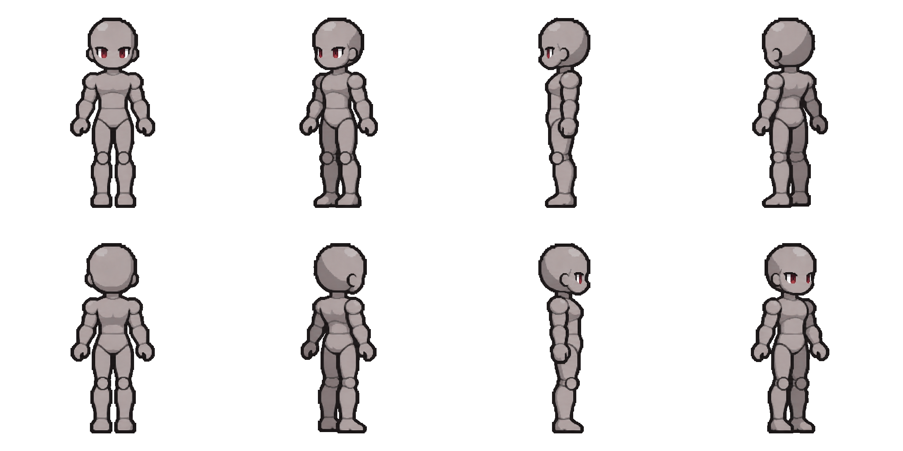
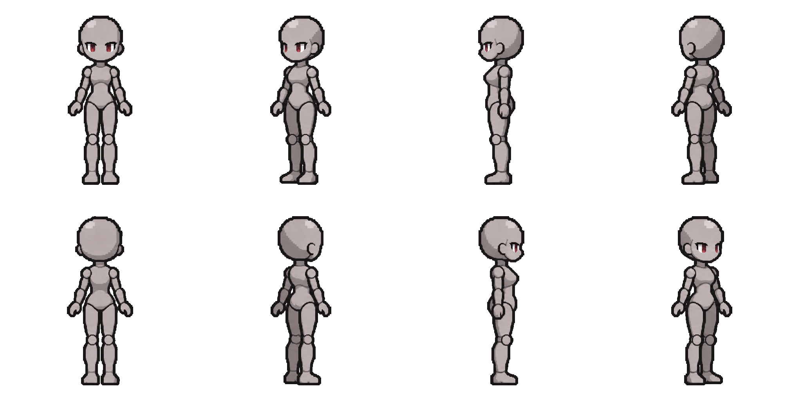

## 작업 결과

남성형·여성형 시트 및 ImageGen 5방향 원본 보존, 제작 가이드 갱신.

## 변경 내용

### 적용 내용

붉은 장교의 SD 비율·눈·도트풍을 참조했습니다. 첫 시안의 큰 머리를 보정하고 남녀 체형을 분리했습니다. 남성형은 넓은 어깨, 여성형은 허리·골반 곡선으로 구분했습니다. 각 시트는 2048×1024이며 위 S/SW/W/NW, 아래 N/NE/E/SE입니다. NE/E/SE는 NW/W/SW의 정확한 좌우 반전입니다.

### 대화 기록
사용자는 잿빛 기사와 붉은 장교의 비율 차이를 지적하고 눈이 있는 기준 마네퀸을 요청했습니다. 후속으로 남성형·여성형 분리를 요청했습니다.

## 검증

실제 생성 이미지와 완성 8방향 PNG 2장 시각 확인. 셀512·시트2048×1024·동일 발 기준 및 코드의 반전 복사 확인. normalize-art 선택 파일 처리와 docs/build.mjs 성공. 테스트·게임 실행은 범위 외로 미실행. SkillEvaluator는 신규 스킬 설치가 없어 비대상, CLI-Anything은 앱 조작 없이 ImageGen 전용 도구로 충족하므로 비대상. 스킬 누락 검사 issues=0.

## 남은 사항

사용자 최종 외형·비율 승인 대기. 기존 기사·장교·런타임 교체는 요청 범위 외입니다. 모바일 첨부 표시는 미확인. 원격 업데이트 조회는 fetch failed, 알려진 최신 ID 2026-11-20-012 적용. 중앙 게시 접근은 배포 후 별도 확인합니다.

## 작업 시간

- 제안 시간: 2026-11-20 14:42:07 KST 시작, 제안 8~10분.
- 실제로 완료된 시간: 제작·저장·시각 확인·문서 빌드 14:45:54 KST, 실측 약3분47초. 중앙 게시 대기 시간과 최종 완료 시각은 publication.json 및 최종 응답에서 구분합니다.
- XERJ: 미사용 — 지침 추가·통합 없음. 기존 512칸·5원본3반전 규칙을 적용했습니다.
