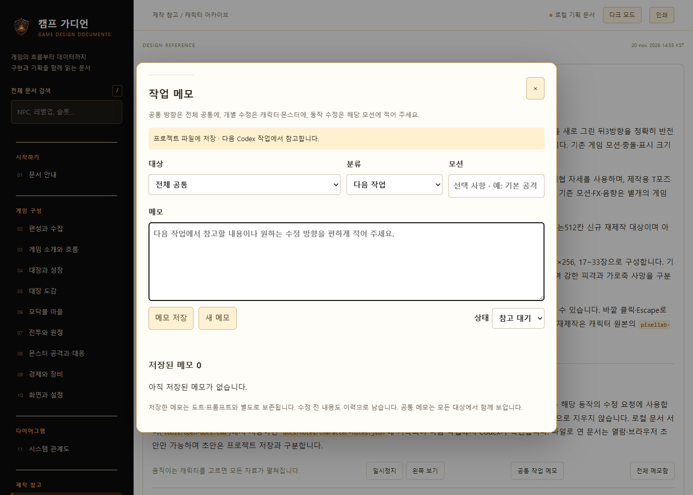

## 작업 결과

문서 상단 작업 메모함, 아카이브 공통·전체 메모함, 캐릭터·모션 아래 메모 버튼 구현. 프로젝트 파일 저장·새로고침 후 복원·수정 이력 보존을 실제 화면에서 확인했습니다.

## 변경 내용

### 적용 내용

docs/notes/character-notes.json을 이미지·프롬프트 출력과 분리했습니다. 대상은 전체 공통 또는 캐릭터/몬스터 ID이며 모션을 선택적으로 붙입니다. 외형·모션·전투·다음 작업·공통 분류와 참고 대기/반영 완료 상태를 제공합니다. 원문 수정 시 history를 보존하고 동시 변경은 revision 충돌로 덮어쓰기를 막습니다. 문서 서버는 127.0.0.1 전용으로 같은 출처 JSON 요청만 저장합니다. 브라우저 초안과 실제 파일 저장을 구분합니다. 파일로 연 정적 문서는 읽기·초안만 지원하고 저장 가능한 로컬 화면으로 안내합니다. tools/open-docs.cmd로 실행할 수 있습니다. AGENTS.md와 제작 지침에 다음 작업 전 공통·대상·모션 메모를 읽고 생성·빌드에서 지우지 않도록 명시했습니다. 사용자 요청을 요약한 공통 보존 메모 하나를 실제 UI에서 저장했습니다.

## 검증

node docs/build.mjs 성공. 실제 문서 서버·Chrome에서 사용자 요청 요약 메모 저장→실파일 revision 증가→새로고침 재열기→수정 전 이력 보존→공통/모션별 진입 촬영. 브라우저 pageerror 0, 실제 7프레임 GIF. 저장 후 빌드에서도 메모 파일이 유지됨. node --check notes.js 및 serve-docs.mjs 성공. 자동 테스트 작성·회귀 테스트 미실행. SkillEvaluator는 스킬 설치·평가 작업이 아니므로 미적용. CLI-Hub 브라우저 검색은 DNS 실패, 이전 성공 경로의 Playwright/Chrome 공식 API 재사용. 원격 업데이트 확인 latest 2026-11-20-011, 최신 사용자 로컬 첨부 지시 우선 적용.

## 남은 사항

로컬 서버가 켜진 PC에서 프로젝트 파일로 저장합니다. 공개 정적 사이트·다른 PC에서의 원격 동기화는 구현 범위에 포함하지 않았습니다. 서버 종료 후에는 tools/open-docs.cmd 실행이 필요합니다. 작성 메모가 향후 작업에 실제로 반영되는지는 해당 작업에서 확인해야 합니다. 모바일 접근·재생 미확인. 중앙 보고서 배포와 공개 미디어 GET은 publication.json으로 별도 확인합니다.

## 작업 시간

- 제안 시간: 8~10분
- 실제로 완료된 시간: 2026-11-20 14:53:17 KST 시작. 구현·저장·UI 확인·GIF 제작 완료 2026-11-20T05:58:10.619190+00:00 (KST=UTC+9). 배포 대기는 별도 publication.json에 기록.
- XERJ: 미사용 — 사용자 지침에 따라 사용하지 않았습니다.
