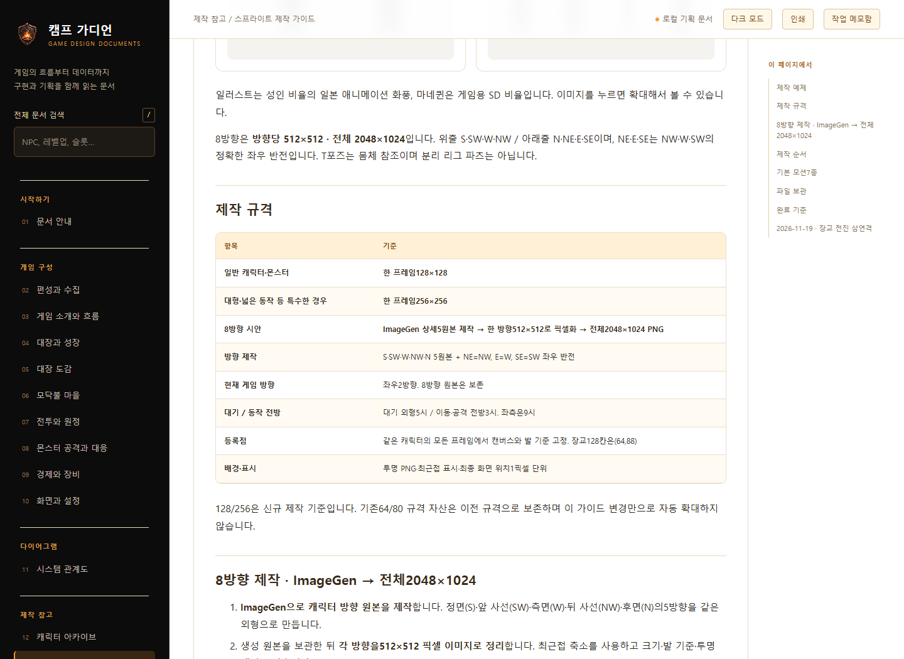

## 작업 결과

일반 문서 표의 머리글·행·테두리·검색 도구 스타일 통일. 데이터 페이지 초록색 유지 확인.

## 변경 내용

### 적용 내용

전역으로 퍼지던 초록색 표 스타일을 :where(#page-data-tables) 안으로 한정했습니다. 일반 문서 표는 연한 주황색 머리글, 흰색·옅은 크림색 행, 사이트 구분선과 둥근 모서리를 사용합니다. 검색 도구와 다크 모드도 같은 범위에서 맞췄습니다. 이미지 예제 카드는 별도 스타일을 유지합니다. 문서 안내에 표 테마 구분을 기록했습니다.

### 대화 기록
사용자는 데이터표를 제외한 표 디자인을 사이트 디자인과 맞춰 달라고 요청했습니다.

## 검증

node docs/build.mjs 성공. 실제 제작 규격 표 캡처·시각 확인. 머리글 배경 rgb(255,240,214)·글자 rgb(117,68,7), 데이터 파일을 열어 시트 도구막대 rgb(33,115,70) 유지 확인. pageerror0·가로넘침 없음. 자동 테스트는 요청되지 않아 미작성·미실행. SkillEvaluator 신규 스킬 설치가 없어 비대상. 기존 공식 Playwright API를 재사용해 CLI-Anything 신규 harness는 비대상.

## 남은 사항

모바일·다크 모드 별도 화면은 미확인입니다. 중앙 보고서·실제 캡처 공개 접근은 배포 후 확인합니다.

## 작업 시간

- 제안 시간: 2026-11-20 15:07:35 KST 시작,5~8분 제안.
- 실제로 완료된 시간: 구현·빌드·실제 화면 확인15:09 KST 완료, 약2분. 중앙 게시·배포 대기 시간은 별도 기록합니다.
- XERJ: 미사용 — 기존 데이터 테이블 페이지에만 시트 UI 적용 규칙을 준수했습니다. 전역 지침 변경 없음. 시작 시 원격 조회 실패, 알려진011과 대화012 적용 후 최종 재확인합니다.
