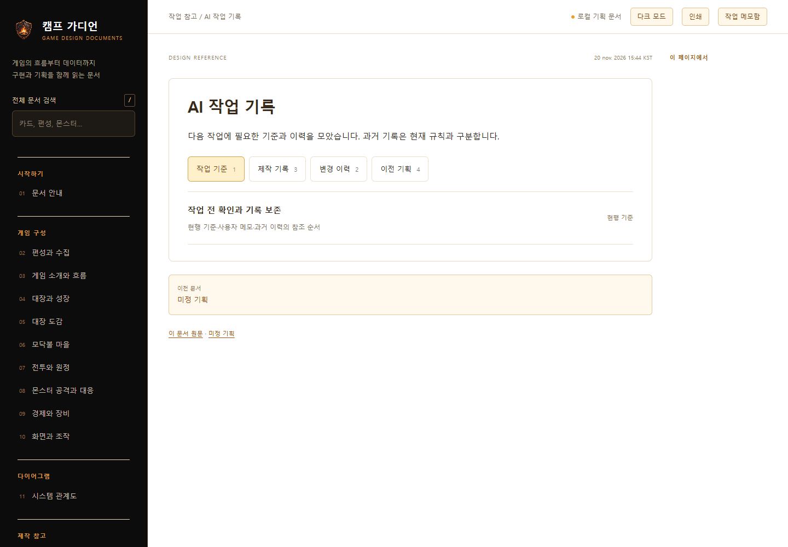

## 작업 결과

사이트에 AI 작업 기록 탭과 내부4개 분류를 추가했습니다. 아카이브에서 분리한 제작 안내·장교 삼연격·개발 영상 기록과 정리 전 기획/관계도/홈/미디어 목록을 복구·연결했습니다.

## 변경 내용

### 적용 내용

docs/ai-log/index.json과 entries Markdown으로 기준·기록을 관리합니다. 작업 기준1건·제작 기록3건·변경 이력2건·이전 기획4건입니다. 원문 경로·복구 출처·당시 날짜/미확인 상태를 표시하며 과거 기획은 현행 아님으로 구분합니다. 보관된 과거 관계도는 텍스트 원문으로 표시해 현재 관계도에 섞이지 않도록 했습니다. 원본 파일은 그대로 보존하고 추적에 필요한 장교·영상 기록을 별도 추출했습니다. 작업 시작 시 관련 기록과 사용자 메모를 읽고, 다음 AI 작업에 필요한 검증된 이유·제약·확인 범위를 갱신하도록 AGENTS.md를 보완했습니다. 원본 세션 로그나 비밀정보를 수록하지 않습니다. 일반 게임·아카이브에 장문 작업 이력을 다시 붙이지 않습니다.

## 검증

node docs/build.mjs 성공(16페이지·현재 관계도4개). node --check ai-log.js 성공. 실제 로컬 서버와 Chrome에서4분류 전환·기록 펼침·새로고침 시 분류 유지·방향키 이동을 확인했습니다. 원문 링크11개 HTTP200, pageerror0, 요청 실패0, 가로 넘침 없음.6프레임 실제 UI GIF 내용 확인. 테스트 작성·회귀 테스트 없음. SkillEvaluator는 스킬 설치·평가 작업이 아니므로 미적용, 기존 확인된 Playwright/Chrome 공식 API 재사용. 원격 지침 조회는 시작 시 제한으로 미확인, 마지막 확인 예정.

## 남은 사항

과거 문서 내용은 당시 기록이며 현재 기능 검증으로 간주하지 않습니다. 원본이 없는 시각·승인·검증은 복원하지 않았습니다. 사용자가 명시적으로 삭제한 자산은 복구하지 않았습니다. 모바일·전체 사이트 회귀 검증은 미실행. 중앙 보고서 배포와 동일 GIF 공개 GET은 publication.json에 기록합니다.

## 작업 시간

- 제안 시간: 8~10분
- 실제로 완료된 시간: 2026-11-20 15:42:34 KST 시작. 구현·원문 연결·실제 UI 확인·GIF 제작 완료 2026-11-20T06:46:16.342237+00:00 (KST=UTC+9). 중앙 배포 대기는 별도 기록.
- XERJ: 미사용 — 사용자 지침에 따라 사용하지 않았습니다.
