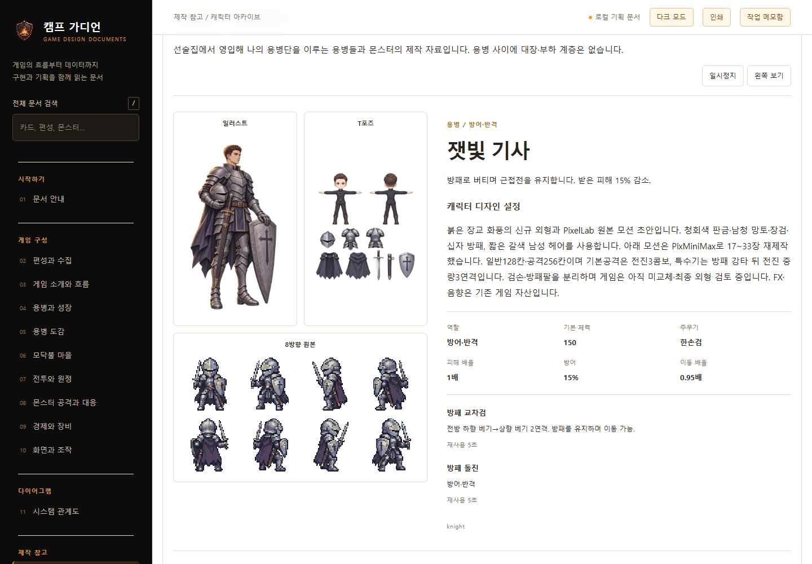
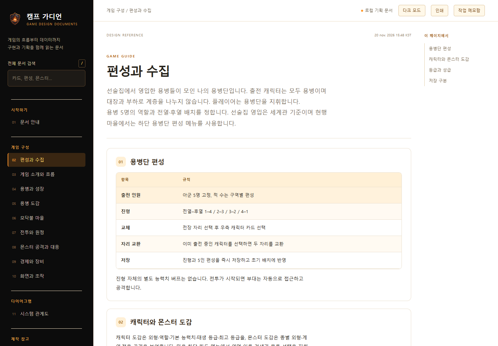

## 작업 결과

선술집에서 영입한 용병이 나의 용병단을 이룬다는 기준을 반영했습니다.

## 변경 내용

### 적용 내용

대장 표기를 용병으로, 원정대 편성을 용병단 편성으로 변경했습니다. 아카이브·도감·표 스키마·생성기·성장 문서와 관련 UI 문자열을 갱신했습니다. 대장간 고유 명칭·저장 호환용 captain_* 식별자·기존 원본은 보존했습니다. 프로젝트 AGENTS.md에 최신 개념을 기록했습니다.

## 검증

node tools/build-design-catalog.mjs 및 node docs/build.mjs 성공. 실제 docs/index.html의 아카이브와 편성 문서를 Chrome headless로 촬영하고 이미지 내용을 확인했습니다. 테스트는 요청되지 않아 실행하지 않았습니다. SkillEvaluator는 스킬 최초 추가가 아니므로 미적용, CLI-Anything 신규 harness는 기존 Playwright API로 충족하여 불필요합니다. 원격 업데이트 확인 성공(latest 2026-11-20-011); 최신 사용자 제공 012 지침 우선 적용.

## 남은 사항

게임 실행·인게임 표시·기존 선술집 영입 동작은 미확인입니다. 이번 변경은 명칭과 개념 정리이며 신규 영입 기능은 구현하지 않았습니다. 스킬 복원 CheckOnly는 PowerShell 실행 정책에 차단되어 미확인입니다. 게임 빌드·푸시·게임 배포는 수행하지 않았습니다. 중앙 보고서 푸시·배포는 후속 게시 기록으로 확인합니다. 모바일 표시 미확인.

## 작업 시간

- 제안 시간: 5~10분
- 실제로 완료된 시간: 2026-11-20 15:46:49 KST 시작, 15:49:30 KST 구현·문서·화면 확인(약 2분 41초). 보고서 배포 대기는 별도 기록.
- XERJ: 미사용 — 사용자 지침에 따라 사용하지 않았습니다.
