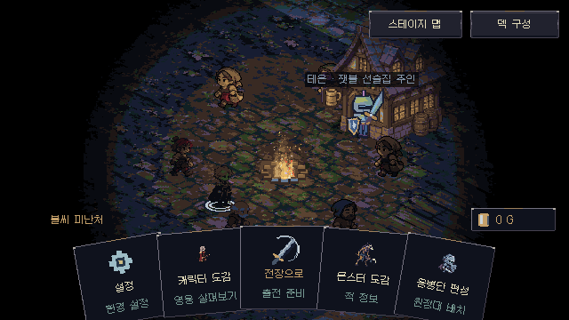

## 작업 결과

구현·Godot 실제 실행·20초 GIF·문서 빌드 완료. 중앙 게시 확인은 publication 기록 참조.

## 변경 내용

### 적용 내용

선술집은 화면상 모닥불 기준 (112,-62)에 배치했습니다. 기존 원본을 보존하고 표시용 166×177 자산을 사용합니다. 플레이어는 모닥불 중심 투영 반경175px에 제한하며 바깥 클릭을 안쪽으로 제한합니다. 주민6명은 독립 연속 경로로 배회하고 경계를 넘습니다. 163~260px 구간을 점진 암전하여 주민·지형이 함께 사라집니다. 기존 전투·마을 하단 카드는 유지합니다.

## 검증

Godot4.7.2 OpenGL GTX970 실제 실행. 주민6·선술집1 확인. 촬영 중 플레이어 최대 투영반경171.927px/제한175px, 외곽400px 지점 이동불가 로그 확인. 엔진 API로150프레임 저장, GIF 640×360·150프레임·프레임 변화 확인. 실제 두 시점 화면에서 주민 이동·외곽 소실과 선술집 배치 확인. node docs/build.mjs 성공(16페이지). 테스트 작성·실행 없음. 종료 시 기존 텍스처 RID 해제 경고 및 NPC 동적 종이인형 relief 누락 경고 있음. 최신 사용자 지침의 매 작업 프로젝트 푸시를 적용하여 원격 main 반영 확인.

## 남은 사항

게임 패키징·게임 배포는 미실행. 프로젝트 main 푸시 d52a781f 완료(핵심 구현은 직전 공유 커밋9381b636에 포함). 모바일 첨부 재생은 미확인. 선술집 영입 서비스 확장은 이번 요청 범위 아님. 지침 변경 없음. SkillEvaluator는 신규 스킬 추가가 없어 미적용. CLI-Hub 목록은 샌드박스 DNS 조회 실패, 기존 Godot CLI·렌더 API 재사용. 스킬 복원 CheckOnly issues=0. 원격 업데이트 최신011 확인, 사용자 제공012 로컬 첨부 지침 우선 적용.

## 작업 시간

- 제안 시간: 약10분(구현·실제 GIF·보고 게시)
- 실제로 완료된 시간: 2026-11-20 15:48:10 KST 시작, 15:52:52 KST 구현·촬영·문서 완료(실측4분42초). 중앙 게시·배포 대기 시간은 publication에 별도 기록.
- XERJ: 미사용 — 사용자 지침에 따라 미사용.
