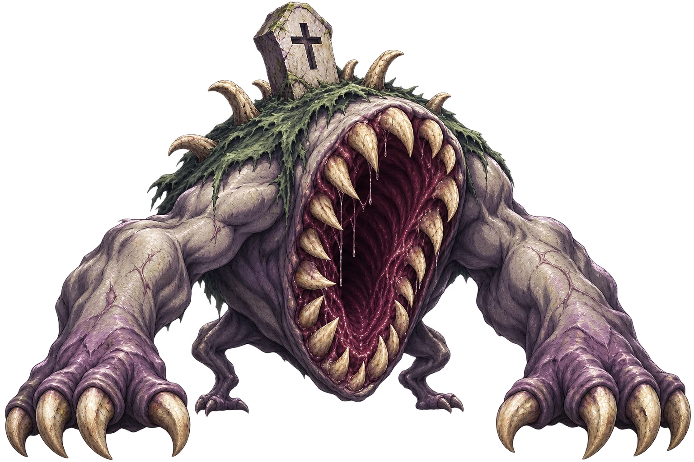
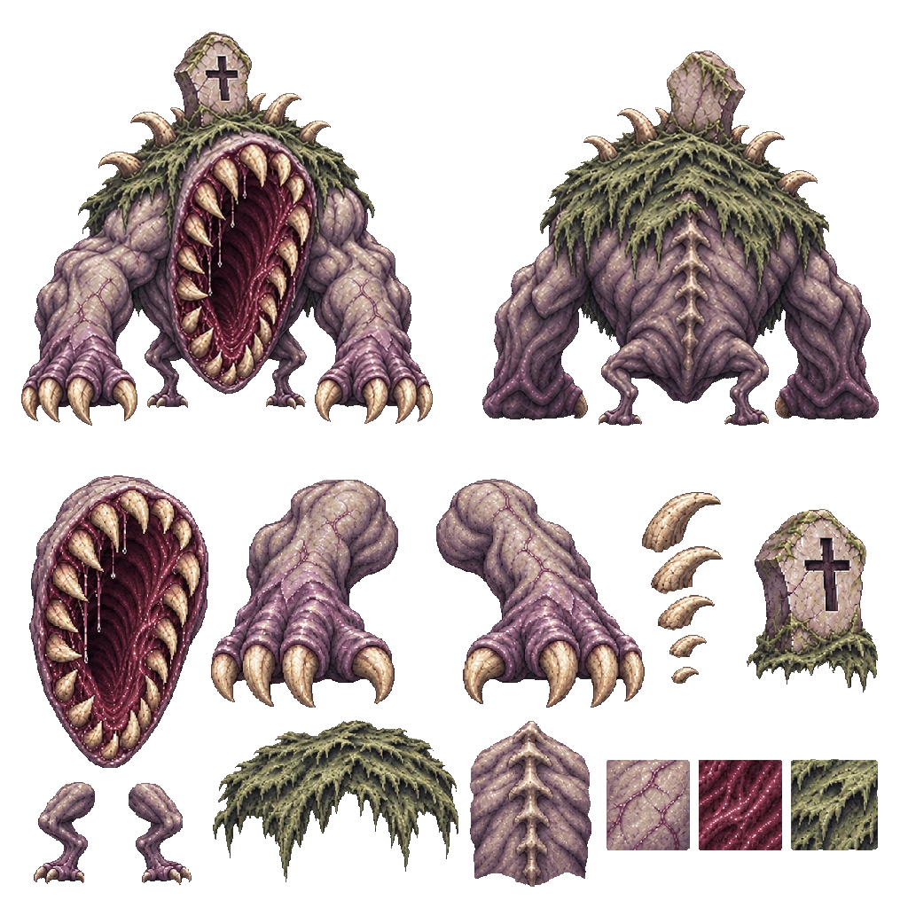
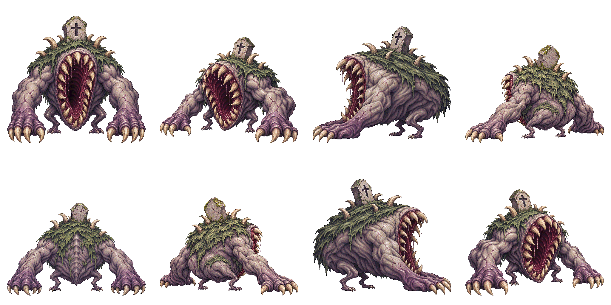
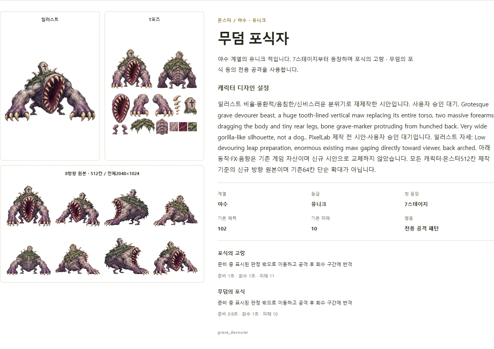

## 작업 결과

무덤 포식자의 일러스트를 직접 참조해 몽환적·음침한·신비스러운 분위기의 정후면 몸체와5방향을 새로 제작했습니다. 몸체 기준도 각512칸,8방향 각512칸/전체2048×1024입니다. 일러스트 자체와 게임 런타임은 유지합니다. 최종 미감 승인은 대기이며 전체 제작은 진행 중입니다.

## 변경 내용

### 적용 내용

Grotesque grave devourer beast, a huge tooth-lined vertical maw replacing its entire torso, two massive forearms dragging the body and tiny rear legs, bone grave-marker protruding from hunched back. Very wide gorilla-like silhouette, not a dog.

일러스트 자세: Low devouring leap preparation, enormous existing maw gaping directly toward viewer, back arched

일러스트·프로필·몸체 정후면·분리 장비·512 방향 원본·512 대기 참조·출처/프롬프트/해시를 art/characters/무덤포식자에 저장했습니다. 문서 아카이브도 같은 시안으로 연결했습니다. 게임 모션·공격·FX는 교체하지 않았습니다.

### 대화 기록
사용자 요청: 누락된 캐릭터/몬스터를 PixelLab 전 단계까지 최신화하고 한 종씩 보고. 몬스터 일러스트는 다양한 자세로 위협적이고 무섭게 제작.

하단의 입·앞팔·등·뼈는 해부학적 상세 참조입니다. 탈착 장비나 실제 분리 리그로 제작한 결과가 아닙니다.

최신 요청: 모든 캐릭터·몬스터·보스의 방향 시안을512칸으로 상세 제작.5방향 각각 ImageGen 신규 제작→512칸 픽셀 파생→3정확한 반전→전체2048×1024.512 대기 참조를 제공하며 이전64/128 방향 파생과 제작 원본은 ZIP에 보존했습니다.

최신 사용자 후속: 작은 몬스터도 대형과 같은 픽셀 해상도와 디테일. 일러스트와 다른 귀여운 SD를 배제하고 몽환적·음침한·신비스러운 외형으로 몸체·방향 일치. 이전 시안은 ZIP 보관했습니다. 아카이브 본문에 최신3종 이미지를 연결합니다.

## 검증

실제 신규5방향 원본과512칸 결과 외형 확인. 전체2048×1024, 칸512×512, NE=NW/E=W/SE=SW 정확한 바이트 반전 확인. 과거 파일 ZIP 보관 후 해시 대조. 기존64칸 이미지를 확대하지 않았습니다. 선택 픽셀 파생만 정규화하고 문서 빌드·게시용 WebP 재열기 확인. PixelLab 호출0회, 게임 연결/실행/회귀 테스트 미실행. 정후면 몸체 각512×512와T포즈 전체1024×1024 저장 확인. 일러스트 직접 참조와 형태 대조. 실제 아카이브 본문 확인 상태는 별도 캡처 기록으로 구분합니다. 실제 docs/index.html#sprite-browser의 해당 종 상세에서 일러스트/T포즈/8방향3종 이미지 로드 및 방향2048×1024 확인 후 캡처했습니다. 캡처 시각 2026-11-20T07:01:53.368Z.

## 남은 사항

최종 사용자 미감 승인 대기. PixelLab/리그 파츠/모션·FX·음향 신규 제작과 게임 연결은 이번 요청 범위 밖입니다. 전체 최신화의 나머지 대상은 진행 중입니다. SkillEvaluator는 스킬 변경이 없어 비대상, CLI-Anything은 GUI 조작 없이 ImageGen 및 기존 파일 API를 사용하여 비대상. 모든 캐릭터·몬스터512칸 기준를 프로젝트 제작 지침과 문서에 반영했습니다. 업데이트 원격 확인 latest2026-11-20-011, 새 채팅 지침의 개별 시안 직접 표시 적용. 이전에 만든 몬스터 시안도 새 분위기 기준으로 재검토·재제작 대상입니다.

## 작업 시간

- 제안 시간: 새 분위기 첫 몬스터 수정본 약10~15분 제안. 나머지 몬스터도 같은 기준으로 순차 재제작하며 전체 최신화는 진행 중.
- 실제로 완료된 시간: 이 종512 재제작 시작부터 최종 저장까지 실측 경과 15.6분. 시작 2026-11-20T15:45:12.748000+09:00, 저장 2026-11-20T16:00:50.896185+09:00 (Asia/Seoul). 타 종 제작·게시 확인을 병행한 경과 시간이며 순수 실작업 시간은 별도 미계측. 이 보고서 푸시 이후 배포 대기는 별도.
- XERJ: 미사용 — 지침에 따라 사용하지 않음. 파일 검색 rg, 기존 이미지와 데이터 대조.
