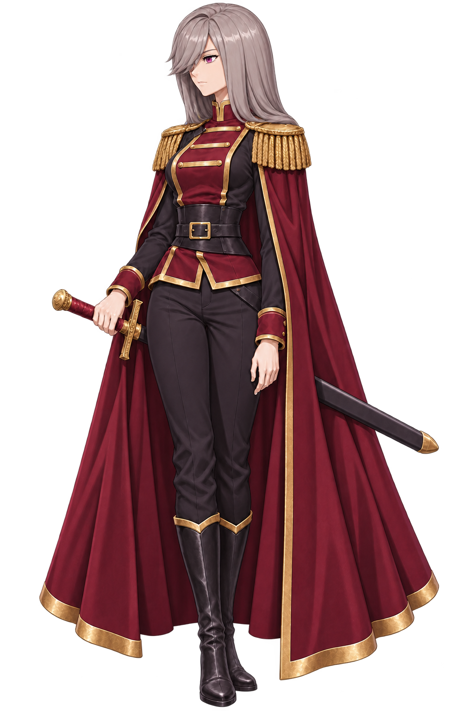
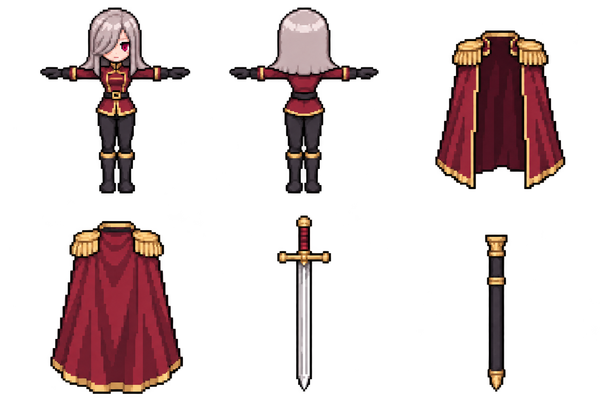
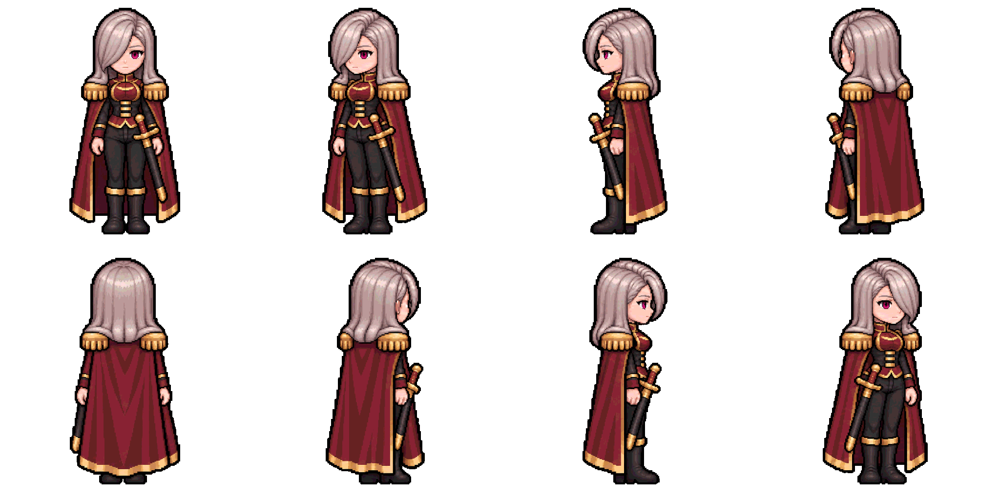
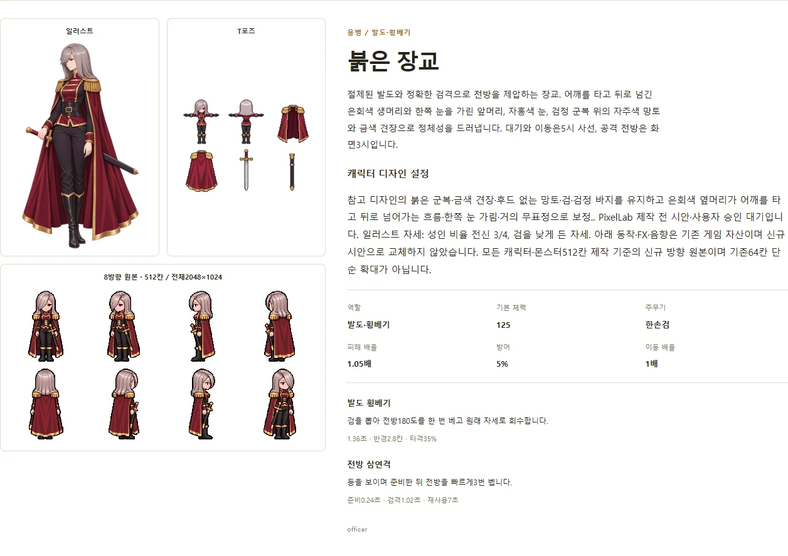

## 작업 결과

최신 요청을 반영한 일러스트·프로필·도트 컨셉 T포즈와 분리 장비·512칸8방향을 저장했습니다. PixelLab은 진행하지 않았으며 최종 외형 검토 대기입니다.

## 변경 내용

### 적용 내용

붉은 군복·금색 견장·후드 없는 망토·검정 바지·검 디자인 유지. 은회색 생머리는 어깨 위를 타고 뒤로 넘어가며 한쪽 눈을 앞머리로 가립니다.5시 사선 얼굴을 재제작했습니다. T포즈도 도트로 제작했습니다. T포즈와8방향은 거의 무표정으로 보정하고 제작 가이드에 기본 규칙을 추가했습니다.5방향 원본을 새로 그리고3방향은 정확히 좌우 반전했습니다. 이전 원본과 사용자 편집본·모션을 보존하고 폐기 시안은 ZIP으로 보관했습니다. 웹 아카이브 설명·3종 이미지 갱신.

## 검증

실제 생성 이미지 외형과 알파 확인, 시트2048×1024·방향당512×512 및3쌍 전체 RGBA 반전 일치 확인. 선택 픽셀 파생만 정규화. 문서 빌드와 실제 아카이브3종 로드·스크린샷 확인. PixelLab 호출0회. 게임 빌드·실행·회귀 테스트는 아트 시안 범위 밖으로 미실행.

## 남은 사항

최종 외형 승인 대기. PixelLab·리그 파츠·게임 연결은 요청대로 미진행. 중앙 게시·배포·HTTPS 확인은 별도이며 대기하지 않음. SkillEvaluator는 새 스킬 설치가 없어 비대상, CLI-Anything은 ImageGen API와 기존 파일 도구로 충족. 스킬 누락0. 원격 업데이트는 미확인, 알려진2026-11-20-014와 최신 사용자 지침 적용. 지침 추가 없음: 기존 제작 규칙 사용.

## 작업 시간

- 제안 시간: 최초10분, 후속 외형 수정 약5분씩 예상.
- 실제로 완료된 시간: 전체 시작2026-11-20 16:02:26 KST, 로컬 저장 2026-11-20 16:19:18 KST, 전체 경과 16.9분(사용자 후속 외형·표정 수정 포함). 마지막 어깨를 통해 뒤로 넘기는 수정은16:17 KST부터. 게시·배포 대기는 별도.
- XERJ: 미사용 — 지침에 따라 사용하지 않음. rg와 실제 파일/API 대조.
