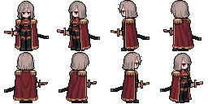
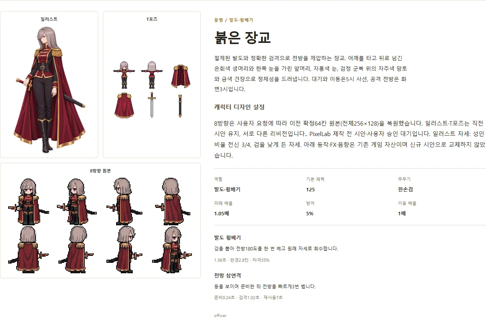

## 작업 결과

보존된 이전 확정 원본을 바이트 그대로 복원했습니다.

## 변경 내용

### 적용 내용

장교8방향 원본 복원,512시안 별도 보존. 향후8방향 기본을64×64칸·전체256×128로 가이드와 프로젝트 지침에 명시.5원본+3반전·거의 무표정 유지. 일러스트·T포즈·모션·런타임은 그대로입니다.

## 검증

복원 파일과 확정64칸 원본 SHA256 동일. 문서 빌드16페이지 통과. 실제 아카이브3종 이미지 로드 및8방향256×128 확인·캡처. 게임 빌드·실행·테스트 미실행.

## 남은 사항

배포·공개 접근 미확인. 원격 업데이트 조회 실패,알려진014와 최신 사용자 지침 적용. SkillEvaluator/CLI-Anything 비대상: 스킬 설치나GUI 조작 없이 기존 파일 도구·렌더 API 재사용. 지침은 요청한8방향 규격만 갱신.

## 작업 시간

- 제안 시간: 3분
- 실제로 완료된 시간: 시작2026-11-20 16:29:43 KST,로컬 저장 2026-11-20 16:31:09 KST. 게시 대기 별도.
- XERJ: 미사용 — rg와 실제 파일 대조
