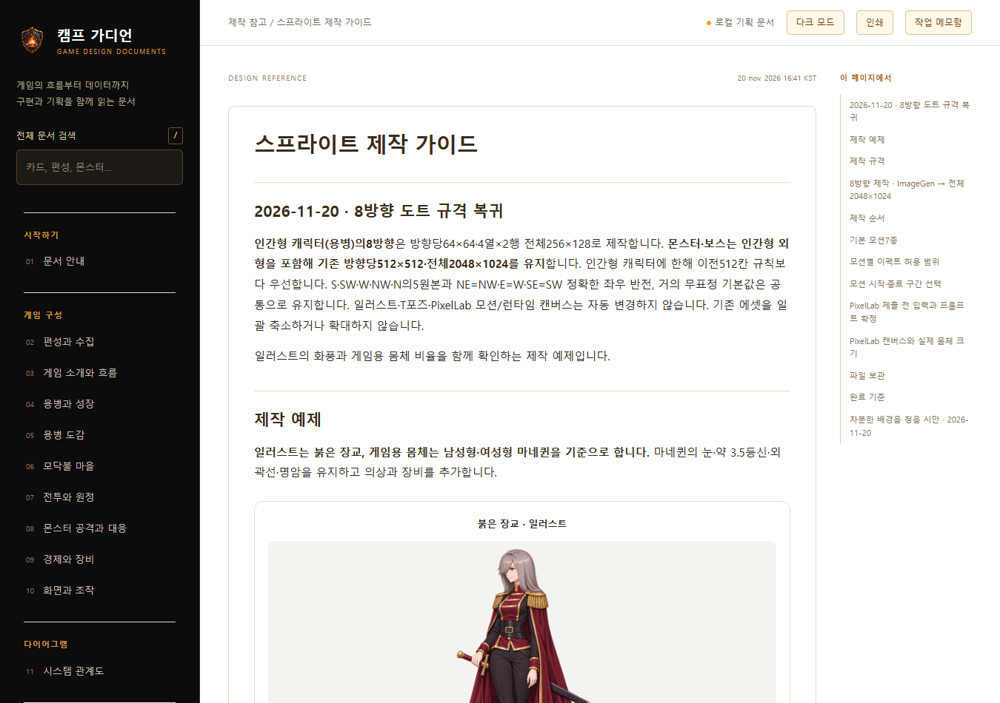

## 작업 결과

8방향 규격 적용 대상을 구분했습니다. 기존 에셋은 변경하지 않았습니다.

## 변경 내용

### 적용 내용

**인간형 캐릭터(용병)의8방향**은 방향당64×64·4열×2행 전체256×128로 제작합니다. **몬스터·보스는 인간형 외형을 포함해 기존 방향당512×512·전체2048×1024를 유지**합니다. 인간형 캐릭터에 한해 이전512칸 규칙보다 우선합니다. S·SW·W·NW·N의5원본과 NE=NW·E=W·SE=SW 정확한 좌우 반전, 거의 무표정 기본값은 공통으로 유지합니다. 일러스트·T포즈·PixelLab 모션/런타임 캔버스는 자동 변경하지 않습니다. 기존 에셋을 일괄 축소하거나 확대하지 않습니다.

## 검증

프로젝트 지침과 제작 가이드2곳 대조. node docs/build.mjs16페이지 통과. 실제 sprite-guide 화면에서 대상별 규격 확인 후 캡처. 게임 실행·테스트 미실행.

## 남은 사항

배포·HTTPS 접근 미확인. 원격 업데이트 조회 실패,알려진014와 최신 사용자 지침 적용. SkillEvaluator/CLI-Anything 비대상: 스킬 설치나GUI 조작 없이 기존 파일·렌더 API 사용. 지침은 규격 적용 대상 정정.

## 작업 시간

- 제안 시간: 약2분
- 실제로 완료된 시간: 시작2026-11-20 16:40:42 KST,로컬 문서 표시 확인16:43:01 KST. 이후 커밋·게시 처리 별도.
- XERJ: 미사용 — rg·원문 대조
