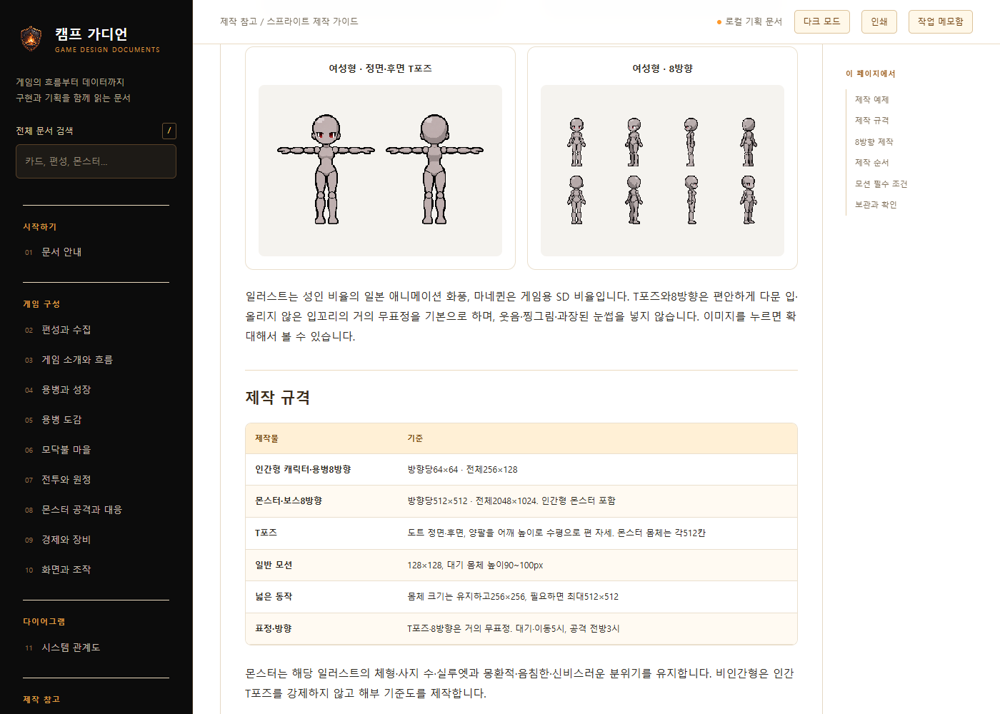
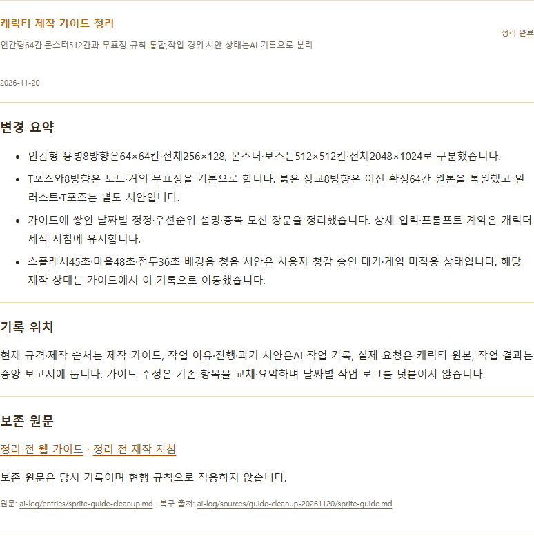

## 작업 결과

가이드에는 현재 규격·순서·필수 조건만 남겼습니다. 변경 경위와 정리 전 원문은 기존AI 작업 기록 탭에서 보존합니다.

## 변경 내용

### 적용 내용

날짜별 규격 복귀·이전 규칙 우선 설명 삭제. 인간형 용병64칸/몬스터512칸을 한 표로 통합하고 제작 순서의 상충 수치도 수정했습니다. 중복 모션 장문은 필수 조건만 요약하고 상세 제작 지침으로 연결했습니다. 배경음 청음 진행 상태는AI 기록으로 이동. 기본 표정·도트T포즈·원본 보존 유지. 가이드와AI 기록의 역할을 기존 작업 전 확인 항목에 통합했습니다.

## 검증

문서 빌드16페이지 통과. 실제 sprite-guide 화면에 규격 복귀·청음 시안 잔존 없음 확인. 기존AI 기록 탭에서 새 요약과 보존 원문 링크 확인·캡처. 게임·이미지 에셋 변경 없음. 테스트는 미작성·미실행.

## 남은 사항

중앙 배포·HTTPS 접근 미확인. 원격 업데이트 미확인,알려진014와 최신 사용자 지침 적용. SkillEvaluator/CLI-Anything 비대상: 스킬 설치·GUI 입력 없이 파일·렌더 API 사용.

## 작업 시간

- 제안 시간: 5분
- 실제로 완료된 시간: 시작2026-11-20 16:45:51 KST,로컬 확인16:48:55 KST. 커밋·게시 별도.
- XERJ: 미사용 — rg와 기존 가이드·AI 기록 원문 대조
