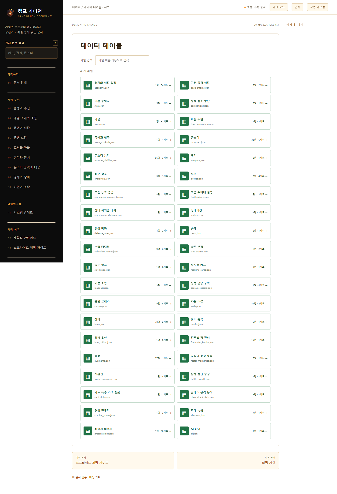

## 작업 결과

현행 데이터 목록과 생성 부록에서 두 표를 제외했습니다. 기존 생성 도구와 미리보기용 JSON은 보존했습니다.

## 변경 내용

### 적용 내용

death_debt와 retainers에 보관 표시를 추가하고 웹 시트와 데이터 부록 생성에 반영했습니다. 프로젝트 원격에 0700ebea와 de32c837이 반영됐습니다.

## 검증

문서와 데이터 부록을 생성했습니다. Chrome에서 표시 목록 40개와 카드 시트 8행을 확인하고 화면을 직접 캡처했습니다.

## 남은 사항

Godot 실행과 중앙 배포의 공개 접근은 미확인입니다. 업데이트 게시판 원격 조회에 실패해 로컬 기록 2026-11-20-014를 사용했습니다.

## 작업 시간

- 제안 시간: 5~8분
- 실제로 완료된 시간: 구현·검증·프로젝트 푸시 3분 26초, 2026-11-20 16:57:37 KST
- XERJ: 미사용 — 코드 검색 근거가 제공되지 않았습니다.
