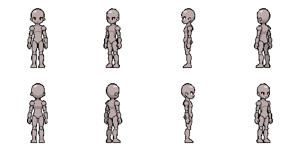
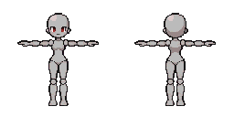
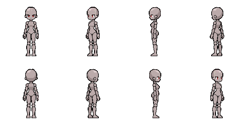
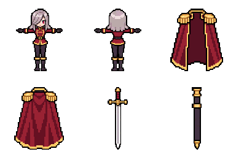
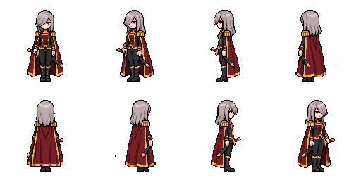
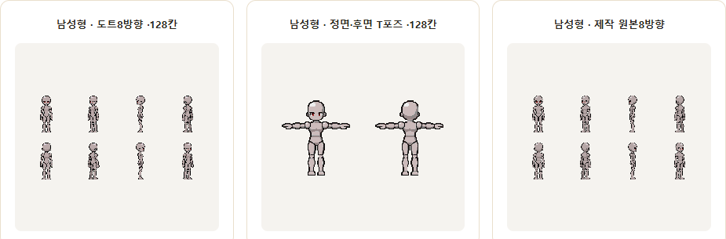

## 작업 결과

ImageGen 신규 원본을 실제128칸 도트로 정리했습니다. 남녀정후면·장교정후면 몸체 높이102px·발(64,116),8방향 전체512×256입니다. 외형 승인 대기·PixelLab 미진행입니다.

## 변경 내용

### 적용 내용

가이드의 기존 규격·몸체 점유·제작 예제를 갱신했습니다. 남녀별 도트8방향→T포즈→제작 원본8방향3열입니다. 기록은 기존AI 작업 기록에 요약하고 원본·프롬프트·실측은 캐릭터별 원본에 보관했습니다. 장교 의상·한쪽 눈 가림·어깨를 통해 뒤로 넘긴 머리·무표정 유지. 몬스터512칸·기존 게임 모션·일러스트는 유지했습니다.

## 검증

남녀·장교T포즈 정후면 높이102px(79.7%)·128칸·발(64,116).3시트512×256과9쌍 정확한RGBA 반전. 생성시 붙은 장교T포즈 배경 제거 후 재처리·시각 확인. 문서 빌드16페이지와 실제3열 이미지 크기/로드 확인·캡처. PixelLab호출0회,게임 빌드·실행·테스트 미실행.

## 남은 사항

외형 승인 대기. 게임 연결·모션 변경은 범위 밖. 배포·HTTPS 접근 미확인. 원격 업데이트 미확인,알려진014와 최신 사용자 지침 적용. SkillEvaluator/CLI-Anything 비대상: 스킬 설치·GUI 입력 없이 ImageGen·기존렌더API 사용.

## 작업 시간

- 제안 시간: 8~10분
- 실제로 완료된 시간: 시작2026-11-20 16:53:48 KST,로컬 확인 2026-11-20 17:01:30 KST. 커밋·게시별도.
- XERJ: 미사용 — rg·실제파일·ImageGen 출력 대조
