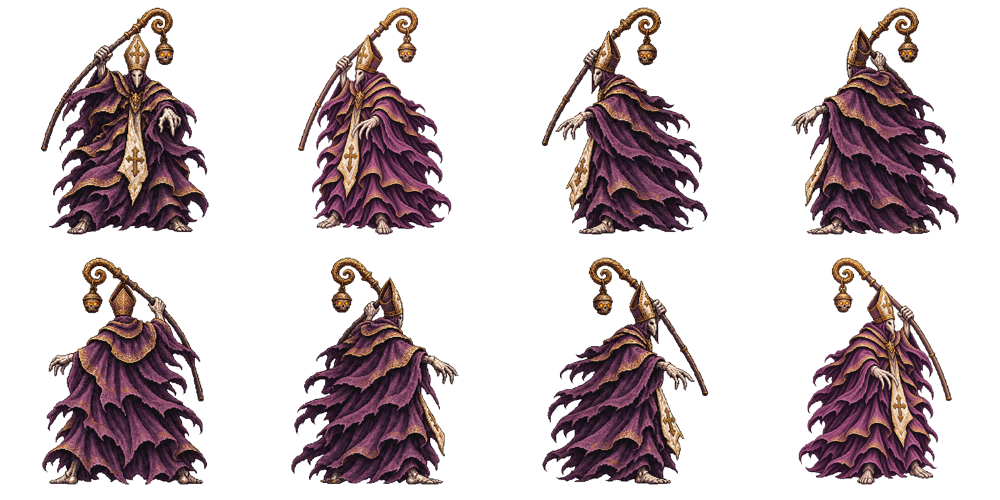
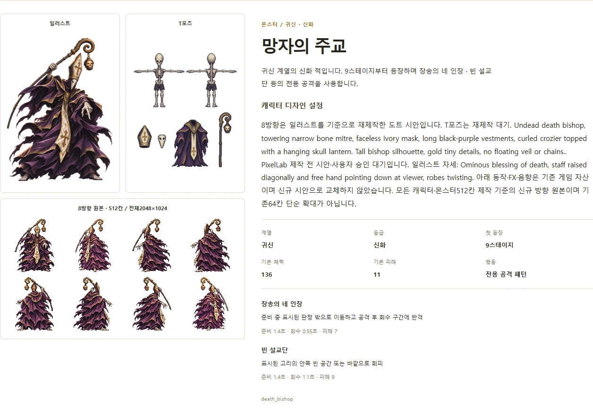

## 작업 결과

망자의 주교의 구형 64px 방향 시트를 교체했습니다.

## 변경 내용

### 적용 내용

ImageGen으로 신규 정면·앞 사선·측면·뒤 사선·후면을 제작한 뒤 세 방향을 정확히 반전해 4열×2행으로 배치했습니다. 새 512px 대기 참조를 제공하고 이전 파일과 제작 원본을 ZIP에 보관했습니다. 기존 일러스트와 T포즈를 참조로 유지했습니다. 전체 몬스터·보스 39종의 8방향을 점검해 확인한 64px 시트 11종 중 3종을 교체했으며, 남은 8종에 512px 재제작 대기 표시를 적용했습니다.

## 검증

투명 배경, 전체 2048×1024, 방향당 512×512, 발 기준선 y=480, 좌우 반전 3쌍의 바이트 대조, 512px 대기 참조와 SE 일치, 문서 빌드를 확인했습니다. 제작용 시안 외형을 기준 일러스트와 대조했습니다. 실제 docs/index.html#sprite-browser의 해당 종 상세에서 일러스트/T포즈/8방향3종 이미지 로드 및 방향2048×1024 확인 후 캡처했습니다. 캡처 시각 2026-11-20T08:05:14.180Z.

## 남은 사항

이 종의 T포즈 재검토와 사용자 외형 승인 대기. 구형 8방향 8종의 교체가 남았습니다. 실제 PixelLab 모션 생성과 인게임 적용은 미실행입니다. 스킬 설치·평가나 GUI 반복 조작이 없어 SkillEvaluator·CLI-Anything은 적용 대상이 아닙니다.

## 작업 시간

- 제안 시간: 목록 분류 약 2분, 첫 제작 및 아카이브 확인 약 5~10분.
- 실제로 완료된 시간: 16:57:50 KST 착수, 2026-11-20 17:05:36 KST까지 실측 7.8분. 생성·검수 병행 경과 시간.
- XERJ: 미사용 — 지침에 따라 사용하지 않음. 파일 검색 rg, 기존 이미지와 데이터 대조.
