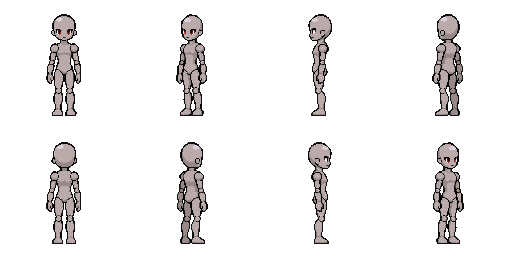
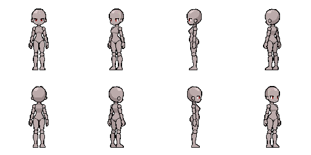

## 작업 결과

남녀 마네퀸만 경계 처리를 적용했습니다. 색상 단계 조절·주변색 대체는 실행하지 않았습니다.

## 변경 내용

### 적용 내용

각 마네퀸의 원본/8방향-후처리전.png를 입력으로 사용. 알파0인 픽셀과 상하좌우로 맞닿은 불투명 픽셀의RGB만(17,17,17)로 변경했습니다. 다른RGB와 모든알파는 입력 바이트 그대로 유지했습니다. T포즈는 고해상도 원본,페이지 소개 순서는 T포즈→원본8방향→도트8방향을 유지합니다.

## 검증

남성 경계2294px·여성2340px 변경. 내부RGBA 변경0·전체알파 변경0.512×256시트·128칸·정확한 반전 유지. 실제PNG 시각 확인. 문서 빌드16페이지 통과. 게임실행·테스트 미실행.

## 남은 사항

붉은 장교는 요청에 따라 추가 수정·게시 대기. 중앙 배포·HTTPS 접근 미확인. 원격 업데이트 조회 실패,알려진014와 최신 지침 적용. SkillEvaluator/CLI-Anything 비대상: 스킬 설치·GUI 조작 없이 기존PNG·파일API 사용.

## 작업 시간

- 제안 시간: 3분
- 실제로 완료된 시간: 시작2026-11-20 17:10:36 KST,로컬 처리17:11:16 KST. 커밋·게시별도.
- XERJ: 미사용 — rg·PNG바이트 대조
