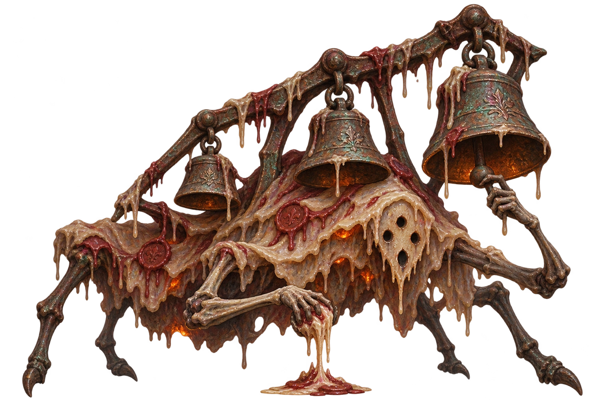
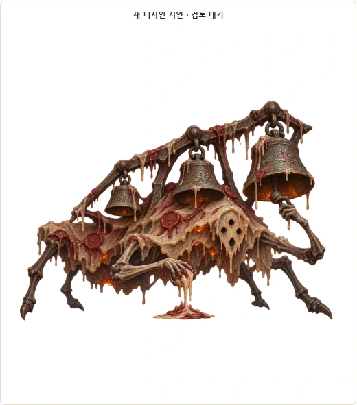

## 작업 결과

네 다리로 기어 다니는 낮고 넓은 밀랍 몸체. 산화된 청동 종 세 개를 등에 걸치고, 두 앞팔로 종을 울리거나 봉인 밀랍을 떨어뜨립니다.

## 변경 내용

### 적용 내용

새 디자인을 별도 원본으로 보관하고 캐릭터 아카이브에서 검토용으로 표시했습니다.

## 검증

ImageGen 원본을 재열어 1536×1024 치수와 새 실루엣을 확인했습니다. 로컬 캐릭터 아카이브에서 새 일러스트와 검토 대기 라벨을 확인하고 캡처했습니다. 중앙 업데이트 원격 최신 ID 2026-11-20-013을 확인했습니다.

## 남은 사항

외형 검토 대기. 신규 디자인의 T포즈·8방향·모션·인게임 적용은 미실행입니다.

## 작업 시간

- 제안 시간: 일러스트 시안 2종 3~6분.
- 실제로 완료된 시간: 2026-11-20 17:09:38 KST 착수, 2026-11-20 17:11:56 KST 원본 저장. 실측 경과 2.3분.
- XERJ: 미사용 — ImageGen과 프로젝트 아카이브 도구 사용.
