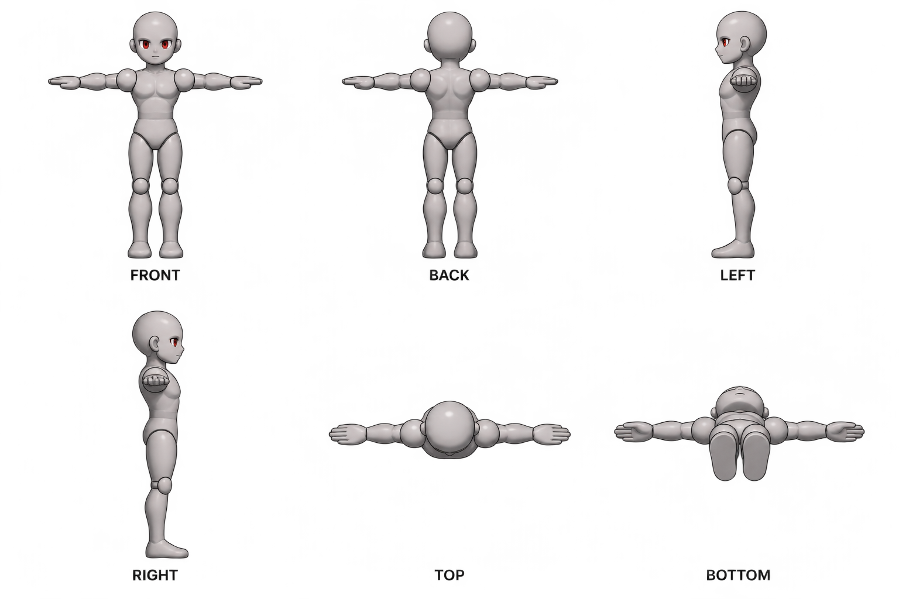
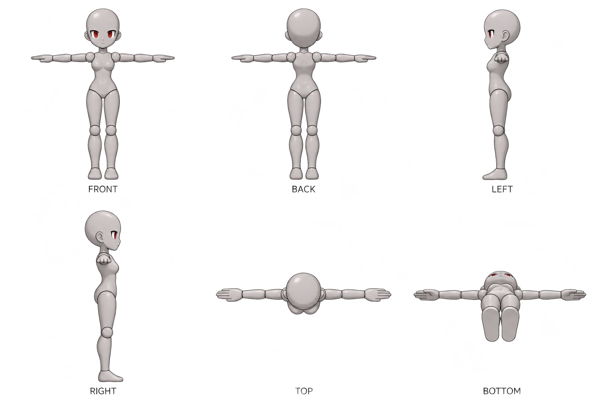

## 작업 결과

남녀 마네퀸의6시점 참조 시트를 갱신했습니다. 위줄 정면·후면·좌측면,아래줄 우측면·상면·하면입니다.

## 변경 내용

### 적용 내용

기존 남녀 체형·회색 마네퀸·붉은 눈·무표정을 참조해6시점을ImageGen으로 제작했습니다. 측면은 동일한T포즈 팔의 단축 모습이며 상하 시점을 포함합니다. 생성 원본 바이트 그대로T포즈.png에 저장. 이전 정후면은 제작기록ZIP에 보존. 가이드의 기존 예제 명칭과 제작 조건 갱신,작업 경위는 기존AI 기록에 요약.8방향 도트와 장교는 변경하지 않았습니다.

## 검증

남녀각1536×1024·3열2행 출력 시각 확인,입력 생성본과저장본 바이트 일치. 실제 가이드의 남녀6시점 이미지 로드와 크기 확인·캡처. 문서 빌드16페이지 통과. PixelLab 호출0회·게임 실행·테스트 미실행.

## 남은 사항

컨셉참조 시트로 외형 승인 대기. 정밀3D 정합은 검증하지 않았습니다. 장교는 재지시까지 대기. 배포·공개 접근 미확인. 원격 업데이트 조회 실패,알려진014와 최신 지침 적용. SkillEvaluator/CLI-Anything 비대상: 스킬 설치·GUI 조작 없이 ImageGen·렌더API 사용.

## 작업 시간

- 제안 시간: 5~7분
- 실제로 완료된 시간: 시작2026-11-20 17:19:54 KST,로컬 확인17:22:53 KST. 커밋·게시 별도.
- XERJ: 미사용 — rg·기존이미지·생성출력 대조
