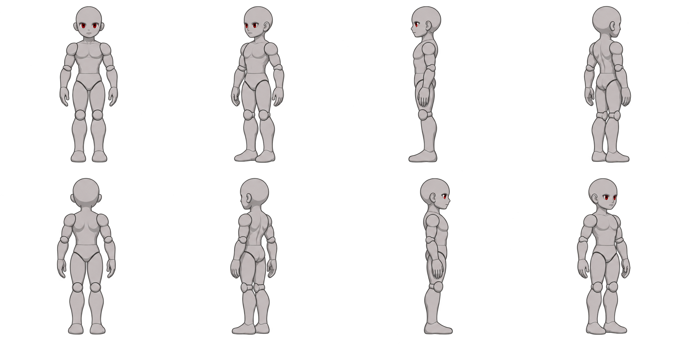
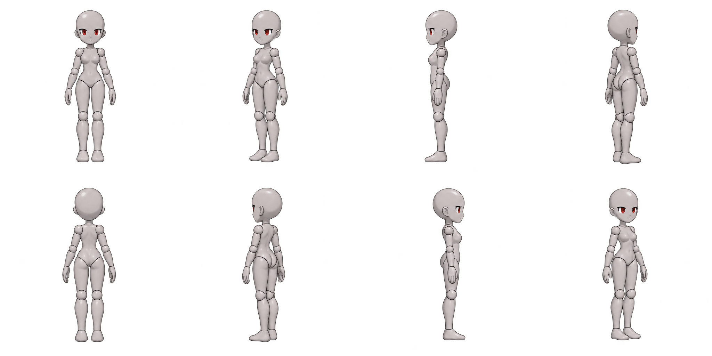

## 작업 결과

새T포즈를 참조한 고해상도5방향과3정확한 반전의 원본8방향을 저장했습니다. 남성형 재질 수정 시안을 적용했으며 외형·재질 승인은 대기입니다.

## 변경 내용

### 적용 내용

정면·앞사선·측면·뒤사선·후면을 새6시점T포즈 참조로 제작. 남성형은 체형·선·자세를 유지하도록 요청하고 광택·반사광을 제거하는 재질 수정. 여성형은 원본 재제작 후 유지. 초기 배경잔상 시안은 미선택으로 보존. 원본은2048×1024,별도색상양자화·도트화·윤곽후처리 없음.5원본을 자르고3반전·배치만 수행. 기존 원본은ZIP 보존,작업 경위는AI 기록에 요약.

## 검증

5원본+3반전6쌍RGBA 일치. 실제 가이드에서 남녀2048×1024원본 로드·캡처,문서 빌드16페이지 통과. 기존T포즈2개·도트8방향2개 Git블롭 해시 동일. 남성형 형태는 시각 비교,픽셀 단위 형태 완전 일치는 보장하지 않음. PixelLab 호출0·게임실행·테스트 미실행.

## 남은 사항

사용자 외형·재질 검토 대기. 장교는 미수정·재지시 대기. 중앙배포·HTTPS 접근 미확인. 업데이트 원격미확인,알려진014와 최신지침 적용. SkillEvaluator/CLI-Anything 비대상: 스킬설치·GUI 조작 없이ImageGen·파일·렌더API 사용.

## 작업 시간

- 제안 시간: 최초5~7분,배경잔상 재생성과 남성재질 추가 수정으로 연장 안내.
- 실제로 완료된 시간: 시작2026-11-20 17:25:09 KST,최종로컬 표시17:34:55 KST. 후속재질 수정 포함,커밋·게시별도.
- XERJ: 미사용 — rg·원본·생성결과·Git해시 대조
