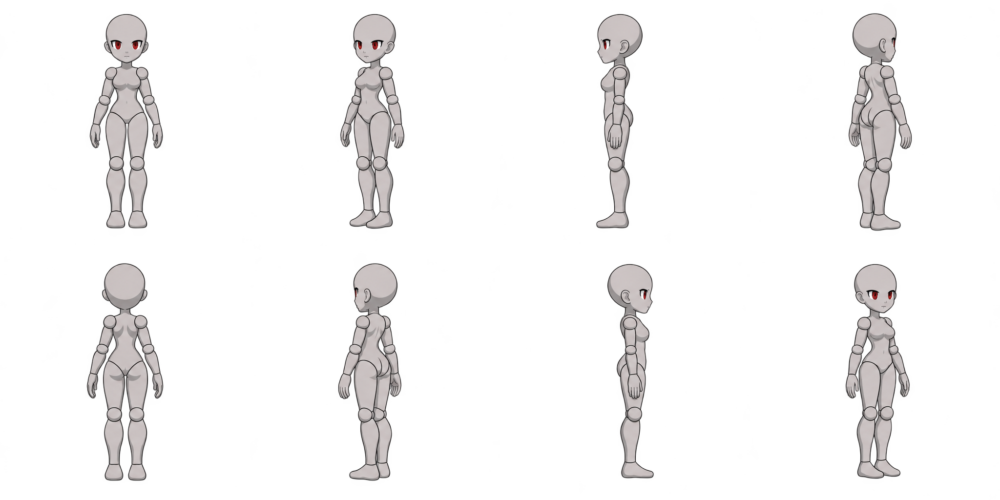

## 작업 결과

여성형 원본8방향에 남성형 무광 재질을 참조한 수정 시안을 적용했습니다.

## 변경 내용

### 적용 내용

ImageGen으로 여성형 체형·얼굴·자세·관절선 유지 및 표면 렌더링만 변경하도록 편집. 광택·반사광·강한 입체 명암을 제거하고 무광 회색 톤 적용.5방향 원본과3정확한 반전으로2048×1024 저장. 별도 색상 양자화·도트화·윤곽 후처리 없음. 이전 여성형 원본은ZIP 보존,작업 경위는 기존AI 기록에 요약.

## 검증

편집 결과 시각 비교,3쌍RGBA 정확한 반전. 남성형 원본·여성형T포즈·도트8방향 Git블롭 해시 동일. 문서 빌드16페이지 통과. 실제 가이드 응답 이미지와 저장PNG 바이트 일치·캡처. 저장EPERM은 동일 경로 권한실행으로 복구. PixelLab 호출0·게임실행·테스트 미실행.

## 남은 사항

사용자 재질·외형 검토 대기. 여성형 형태의 픽셀 단위 완전 일치는 보장하지 않으며 시각 비교 범위. 장교 미수정·대기. 중앙배포·HTTPS 미확인. 업데이트 원격미확인,알려진014와 최신지침 적용. SkillEvaluator/CLI-Anything 비대상: 스킬설치·GUI 조작 없이ImageGen·파일·렌더API 사용.

## 작업 시간

- 제안 시간: 3~5분
- 실제로 완료된 시간: 시작2026-11-20 17:39:13 KST,로컬 표시확인17:41:51 KST. 커밋·게시 별도.
- XERJ: 미사용 — rg·입력/결과·해시/응답 대조
