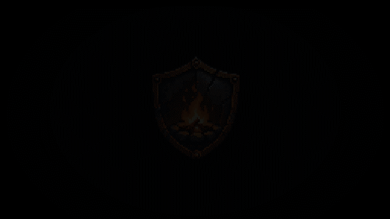
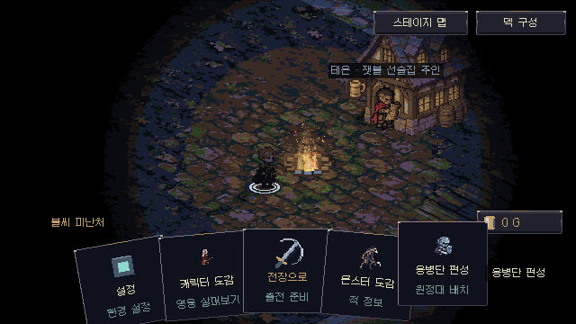
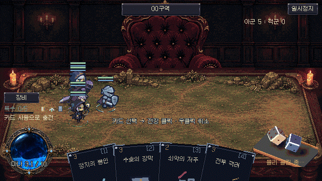

## 작업 결과

마을 배치, 스플래시, 전투 배경과 주요 HUD를 Godot 씬에서 편집할 수 있습니다.

## 변경 내용

### 적용 내용

town_layout.tscn이 현행 오브젝트 배치를 제공하고 town.tscn과 battle_set.tscn이 HUD를 함께 표시합니다. splash.tscn에 배경·로고·문구를 배치했습니다.

## 검증

Godot 4.7.2에서 실행해 스플래시, 선술집 1곳과 마을 HUD, 5대6 첫 전투와 HUD를 엔진 프레임으로 확인했습니다. GIF 48·24·35프레임을 각각 다시 읽었습니다. 게임 종료 시 렌더 리소스 정리 경고가 기록됐습니다.

## 남은 사항

덱·도감·설정 등 보조 창, 지형 생성과 일부 동적 UI 내부의 배치 상수가 남아 있습니다. 사용자가 열어 둔 편집기 재로드는 미확인입니다.

## 작업 시간

- 제안 시간: 최초 마을 수정 기준 5~8분
- 실제로 완료된 시간: 2026-11-20 17:36~17:47 KST, 약 10분
- XERJ: 미사용 — Godot 엔진과 Git으로 직접 확인했습니다.
